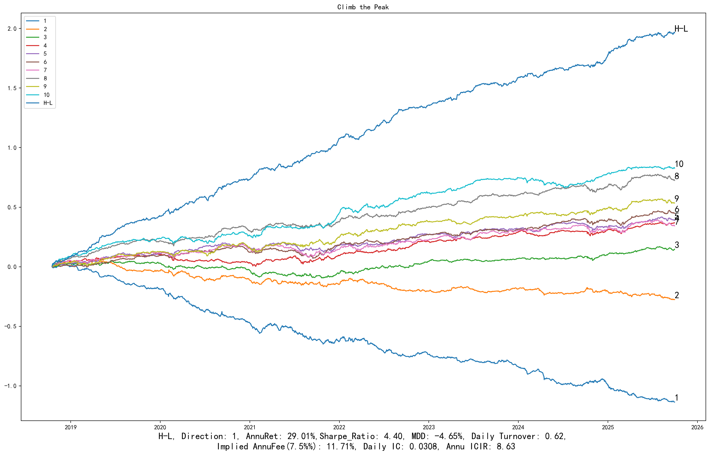
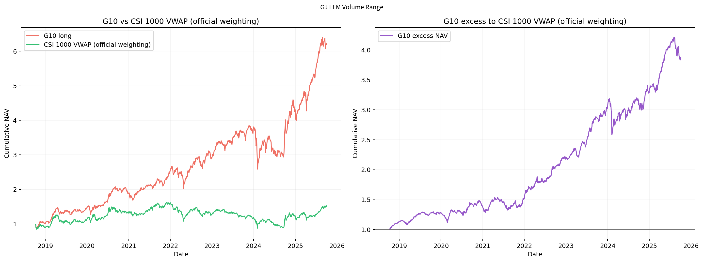

<p align="center">
  
</p>

# Quantitative Research and Alpha Engineering

**市场微观结构、关系网络与行为金融驱动的系统化 Alpha 研究。**

我是 [George](https://github.com/georgefangzhou-glitch)。我的研究以 A 股横截面选股为核心，覆盖日频、分钟、逐笔成交与盘口信息，贯穿数据核查、信号构造、风格剥离、分量消融、跨股票池回放和结果审计，并向期货事件研究与美股日内研究拓展。

我关注的不只是发现一个统计关系，而是把研究问题推进到**口径明确、时间可交易、结果可核查、适用范围可解释**的研究结论。

> Equity alpha research across market microstructure, analyst networks and trading behaviour. Selected historical results, cross-universe experiments and executable research-validation examples.

| 已完成的代表性实验 | 精选多头结果 | 精选排序结果 |
| :--- | :--- | :--- |
| **11个信号 × 3个历史指数池 = 33组正式回放**，同区间1,692个交易日 | 价量区间案例：**G10毛超额年化20.39%** | 换手增长稳定性案例：**H-L Sharpe 4.42** |

上面两项绩效来自不同案例。均为回顾性历史毛收益；完整日期、股票池、基准和选择口径见[真实回测图集](docs/results/README.md)。

## Ten Factors: Historical Backtests

**十个因子、三个历史指数池、30组回测、120张原始图。** 中证1000、中证500、沪深300分别列示，包含较弱结果；日期和处理版本见各页。

| 因子 | 中证1000 G10超额年化 | 中证500 G10超额年化 | 沪深300 G10超额年化 |
|---|---:|---:|---:|
| [分析师共同覆盖改进反转](docs/results/ten/analyst-co-coverage-reversal.md) | 12.40% | 9.70% | 6.36% |
| [反转残差非孤立成交不平衡](docs/results/ten/residual-non-isolated-trade-imbalance.md) | 13.76% | 6.62% | 4.43% |
| [换手率分布均匀度](docs/results/ten/turnover-distribution-uniformity.md) | 10.51% | 3.65% | 3.05% |
| [信息分布均匀度](docs/results/ten/information-distribution-uniformity.md) | 13.40% | 4.43% | 0.82% |
| [分钟理想振幅](docs/results/ten/minute-ideal-amplitude.md) | 8.35% | 0.26% | 4.26% |
| [勇攀高峰](docs/results/ten/climb-the-peak.md) | 12.22% | 4.24% | -0.67% |
| [时间重心偏离独立分项](docs/results/ten/intraday-time-center-divergence.md) | 7.83% | 5.20% | 4.82% |
| [上涨价变共振分项](docs/results/ten/upward-price-resonance.md) | 11.17% | 5.65% | -0.78% |
| [换手率变化稳定性](docs/results/ten/turnover-growth-stability.md) | 6.71% | 2.67% | -8.77% |
| [高于收盘价主动买量占比](docs/results/ten/regret-aversion-buying-volume.md) | 3.58% | 3.69% | 5.40% |

[查看十因子完整图集与口径 →](docs/results/ten/README.md)

## Selected Research Results

以下精选结果以 **G10超额表现、分层质量和研究代表性**为展示依据，图表保留原始输出。超额基准统一为中证1000官方历史权重下的日VWAP研究序列。

| 全市场研究案例 | G10超额年化 | G10绝对Sharpe | H-L Sharpe | 日Rank IC | 区间 |
| :--- | ---: | ---: | ---: | ---: | :--- |
| [Volume and Price Range](docs/results/README.md#volume-and-price-range) | **20.39%** | 1.45 | 2.81 | 0.0566 | 2018-10-08—2025-09-30 |
| [Turnover Growth Stability](docs/results/README.md#turnover-growth-stability) | **15.26%** | 1.06 | **4.42** | 0.0272 | 2018-10-09—2025-09-30 |

| 中证1000历史成分股内选股案例 | G10超额年化 | G10绝对Sharpe | H-L Sharpe | 日Rank IC |
| :--- | ---: | ---: | ---: | ---: |
| [Residual Non-Isolated Trade Imbalance](docs/results/README.md#residual-non-isolated-trade-imbalance) | **13.76%** | 1.24 | 3.47 | 0.0168 |
| [Analyst Co-Coverage Reversal](docs/results/README.md#analyst-co-coverage-reversal) | **12.40%** | 0.97 | 2.48 | 0.0217 |
| [Climb the Peak](docs/results/README.md#climb-the-peak) | **12.22%** | 1.04 | **4.40** | 0.0308 |
| [Pre-Decline Turnover Signature](docs/results/README.md#pre-decline-turnover-signature) | **10.35%** | 1.04 | **4.33** | 0.0369 |

四个指数内案例均为2018-10-17—2025-09-30。年化采用日收益均值×250，Sharpe按250日；未扣交易成本。这些是筛选后的研究结果，不是独立未见样本或实盘收益。

### 从信号到分层

**Climb the Peak · 中证1000内 · 行业与规模中性版本**



### 从分层到多头超额

**Volume and Price Range · 历史沪深A股 · 日频研究适配版**



**[查看十个因子的三池完整图集 →](docs/results/ten/README.md)** · [保留的六个精选案例](docs/results/README.md)

## Research Coverage

| 研究方向 | 我推进的工作 | 可查看的证据或入口 |
| :--- | :--- | :--- |
| **关系网络与相对定价** | 分析师共同覆盖、直接与间接关系区分、相对反转、覆盖与可得性核查 | [分析师网络案例](docs/factors/analyst-co-coverage-reversal.md) |
| **逐笔成交与市场微观结构** | 非孤立成交不平衡、主动买入行为、盘口信息与成交时点、残差化对照 | [成交不平衡四图](docs/results/README.md#residual-non-isolated-trade-imbalance) |
| **高频信息日频化** | 分钟振幅、波动结构、信息分布、成交活动的跨日聚合与排序 | [因子研究目录](docs/factors/README.md) |
| **分量与增量信息** | 共振分量独立评估、相关性、行业规模处理及收益风格对照 | [分量拆解研究](docs/cases/02-signal-decomposition.md) |
| **跨股票池泛化** | 固定构造，对历史1000／500／300池进行同口径回放，识别信号失效范围 | [跨池实验与适用边界](docs/research-scope.md#cross-universe-evidence) |
| **事件与跨资产探索** | 股指期货交割窗口的持仓迁移研究、美股日内研究与执行完整性诊断 | [研究覆盖与拓展方向](docs/research-scope.md) |
| **研究工程与可信度** | 多源数据口径、分批任务、版本锁定、时序测试、分组恒等式与哈希复核 | [研究环境](docs/research-environment.md) · [可运行验证样例](docs/reproducibility.md) |

## Research Ownership

我在研究中重点承担问题定义、数据与价格口径选择、实验设计、版本比较、错误定位和结果解释。公开研报与论文提供部分原始研究思路；研究实现复用既有公司回测接口，并通过参数锁定、分量拆解、股票池对照和校验记录形成可追溯证据。

公开页面展示真实汇总成果与高层研究逻辑。真实因子构造源码、逐股信号、数据库接口和商业数据保留在研究环境中。代码与文档使用AI辅助开发和整理；可运行教学代码与真实研究实现的范围见[披露说明](docs/disclosure.md)。

## 从这里开始

- **先看成果：** [真实回测图集与指标](docs/results/README.md)。
- **再看研究范围：** [研究覆盖、已完成证据与下一步](docs/research-scope.md)。
- **看具体研究对象：** [10个因子：英文名称与中文介绍](docs/factors/README.md)。
- **深入看一个案例：** [Analyst Co-Coverage Reversal](docs/factors/analyst-co-coverage-reversal.md)，解释共同覆盖关系、相对反转、版本区别与反证。
- **了解研究环境：** [技术栈、研究流程与验证规范](docs/research-environment.md)，只展示工作方式，不提供内网环境或真实数据接入。
- **查看通用研究思路：** 浏览下面四个主题。
- **检查工程能力：** 在本地运行合成数据样例和自动测试，全程不需要数据库、密钥或商业数据。
- **查看披露范围：** [公开内容边界](docs/disclosure.md)；[本版验证记录](docs/validation.md)。

## Ten Selected Factors

因子采用英文展示名，介绍使用中文。目录按研究代表性组织；已获准公开的真实图表和汇总绩效集中在[结果图集](docs/results/README.md)。

| English name | 中文介绍 |
| :--- | :--- |
| [Analyst Co-Coverage Reversal](docs/factors/analyst-co-coverage-reversal.md) | 利用分析师共同覆盖关系，研究股票相对直接关联公司的价格反应差异与修复可能。 |
| [Residual Non-Isolated Trade Imbalance](docs/factors/residual-non-isolated-trade-imbalance.md) | 观察非孤立成交的买卖不平衡，研究剥离规模与同期涨跌后是否仍有增量信息。 |
| [Turnover Distribution Uniformity](docs/factors/turnover-distribution-uniformity.md) | 从分钟换手率的波动及其跨日稳定性，研究交易活跃度是否均匀分布。 |
| [Information Distribution Uniformity](docs/factors/information-distribution-uniformity.md) | 从日内收益波动的跨日变化，研究价格信息是持续释放还是集中冲击。 |
| [Minute Ideal Amplitude](docs/factors/minute-ideal-amplitude.md) | 比较较高与较低价格位置附近的分钟振幅，区分同样波动背后的不同路径。 |
| [Climb the Peak](docs/factors/climb-the-peak.md) | 联合考察局部波动状态的变化与稳定性，研究价格过程的波动结构。 |
| [Intraday Time-Center Divergence](docs/factors/intraday-time-center-divergence.md) | 比较上涨与下跌发生的时间重心，研究涨跌力量在日内何时集中。 |
| [Upward Price Resonance](docs/factors/upward-price-resonance.md) | 从个股与市场上涨活动的同步程度，研究共同波动之外的截面差异。 |
| [Turnover Growth Stability](docs/factors/turnover-growth-stability.md) | 研究换手率变化是否稳定，而不是单纯寻找换手率高或低的股票。 |
| [Regret-Aversion Buying Volume](docs/factors/regret-aversion-buying-volume.md) | 观察主动买入成交在收盘时的相对价格位置，研究不同成交群体的行为差异。 |

## 四个研究主题

主题页连接研究问题、实验设计与已公开成果；每项研究的证据范围在对应页面说明。

| 主题 | 想回答的问题 | 当前可公开内容 |
| :--- | :--- | :--- |
| [01 · 关系网络与信息扩散](docs/cases/01-coverage-networks.md) | 股票之间的关联能否带来额外信息，而不仅是行业或规模相似？ | 方法说明、时间可得性与反证设计 |
| [02 · 分量拆解与增量信息](docs/cases/02-signal-decomposition.md) | 一个复合信号的收益，究竟来自哪个分量？ | 消融实验、相关性口径与选择偏差讨论 |
| [03 · 跨股票池适用边界](docs/cases/03-universe-transfer.md) | 全市场有效，是否意味着在不同指数内也有效？ | 11信号、3指数池的真实回放与边界分析 |
| [04 · 回测可信度](docs/cases/04-backtest-integrity.md) | 一条漂亮曲线，经过时序和缺失检查后还成立吗？ | 可运行的独立合成数据样例与测试 |

## 两条命令，检查样例

需要 Python **3.10+**，无第三方运行依赖。在仓库根目录执行：

```bash
python -m unittest discover -s tests -v
python -m workshop_lab --output artifacts/demo
```

第二条命令会从固定随机种子生成虚构股票与价格，输出：

```text
artifacts/demo/
├── summary.json     # 数据身份、覆盖数量、相关性和恒等式误差
└── ledger.csv       # 每个合成股票池、每个记账日的对齐与分组结果
```

再次运行时请使用新的输出目录，例如 `artifacts/demo-2`。样例保留预热期与不可计算日期的状态，不删除这些日期来美化结果。

### 这个样例实际验证什么？

1. **可得时间与收益标签：** 收盘后信号只能匹配次日入场；在本例的退出日标记下，收益行在信号日之后两个交易位置。
2. **历史股票池：** 使用信号日成员资格，而不是收益记账日或今天的成员；全市场也不等于几个子池的并集。
3. **缺失与覆盖：** 未知价格不填零，已选股票收益缺失时明确报错，预热期不压缩日历。
4. **分组与相关性：** 检查 `H-L = G10 - G1`、绝对／超额收益还原、逐日 Spearman，以及 `mean(abs(corr))`。

完整的[运行与口径说明](docs/reproducibility.md)区分已验证和没有实现的功能。这里不是生产回测引擎，也没有撮合、冲击成本、融券或容量模型。

## 内容与贡献说明

- 仓库中的 Python 样例为公开展示独立编写，不复制公司研究库；没有连接真实行情源。
- 研究主题页是方法说明，不宣称其中的通用方法或经典研究问题属于原创。
- 使用 AI 辅助整理文档和实现样例；研究解释、代码审阅与可复现性检查仍需由维护者负责。
- 真实历史图表与汇总绩效按当前公开范围展示；商业数据、私有因子面板、研报全文和公司代码不随之发布。
- 合成教学样例用于检验通用工程问题；真实研究图片与指标来自单独的历史研究结果。
- 未默认授予额外的软件或数据许可；若需要复用，请先讨论合适的授权范围。

## 更新

见 [更新记录](CHANGELOG.md)。仅在有新证据、可运行实现或实质性更正时更新，不以提交数量代替研究质量。

**联系：** 请通过本仓库的 GitHub Issues 交流公开方法和样例问题；不要提交商业数据、凭证或未经授权的研究资料。

*Historical research results are selected, gross and retrospective. The executable lab is synthetic-only. Neither is a live investment track record.*
