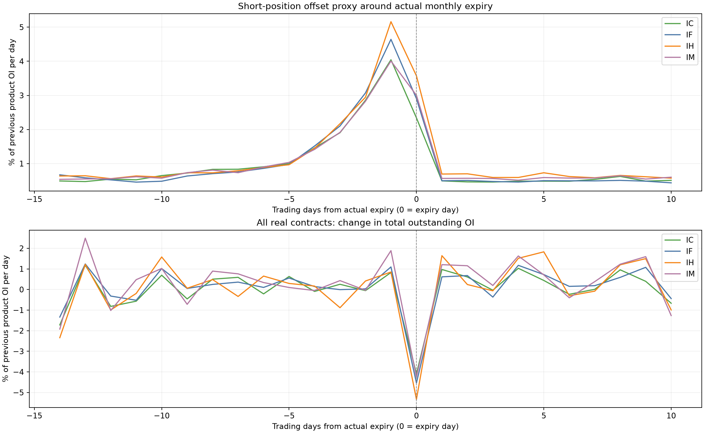

# Research Coverage and Frontier

我的研究主线是：从市场行为与信息结构提出假设，将其转化为有明确数据口径、交易时间和检验边界的量化研究。 A股横截面Alpha是当前主要实证方向；美股多因子选股、虚拟货币OU套利、ETF套利学校项目与股指期货事件研究，拓展了我对不同市场信号、组合构建与交易机制的认识。

## 研究能力与覆盖

| 范围 | 已开展的研究工作 | 继续向外拓展的方向 |
| --- | --- | --- |
| 关系与信息扩散 | 分析师共同覆盖、直接与间接关联、相对反转、关系更新与价格信号更新分离 | 更严格的首次可得历史、文本竞争关系与新闻关联 |
| 高频价格与成交行为 | 分钟振幅、波动变化、成交不平衡、换手分布、价量共振分量 | 跨市场状态的非线性与交互效应 |
| 风格与增量信息 | 行业规模处理、收益残差、分量独立评估、逐日横截面相关性 | 在冻结的验证方案下检验组合增益与成本后增量 |
| 组合研究 | 十组排序、G10绝对与超额、相对回撤、换手、历史指数内选股 | 容量、约束优化、成本和实际可执行组合 |
| 期货事件 | 股指期货交割日对齐、会员跨合约持仓变化、跨月份与年度对照 | 盘口与成交对价格冲击及后续修复的验证 |
| 美股选股与日内研究 | UNSW学校项目中的多因子打分与组合研究；另开展日内事件及退出价格覆盖诊断 | 因子增量、风险暴露、成本与可交易性评估 |
| 虚拟货币与ETF套利 | UNSW学校项目中的OU均值回复、配对价差与ETF套利研究 | 均值回复稳定性、阈值敏感性及交易成本 |
| 统计建模与工程 | 横截面残差、相关性、状态分解、OU小样本探索、时间对齐与合成边界测试 | 稳定性更强的滚动样本外检验与模型比较 |
| 基本面与文本 | 已启动财务指标及财报可得性相关研究，梳理文本关系类因子方法 | 财报vintage、更新滞后与价格信号的互补性 |

“已开展”包含不同成熟度：A股精选案例有正式历史结果；期货图属于观察性事件研究；美股多因子与虚拟货币OU套利在此按学校项目介绍，其他美股日内、OU盘口及部分基本面方向仍处于探索或诊断阶段。学校项目不计入A股绩效统计。

## Cross Universe Evidence

已完成一项 11个信号 × 中证1000／中证500／沪深300 = 33组的历史投资范围实验。同区间为2018-10-17—2025-09-30，共1,692个记账交易日，保留信号构造与处理方式，只改变历史投资资格。

| 代表性信号 | 1000内H-L Sharpe | 500内H-L Sharpe | 300内H-L Sharpe |
| --- | ---: | ---: | ---: |
| Climb the Peak | 4.40 | 1.60 | 1.00 |
| Pre-Decline Turnover Signature | 4.33 | 2.28 | 1.12 |
| Residual Non-Isolated Trade Imbalance | 3.47 | 1.69 | 1.42 |
| Analyst Co-Coverage Reversal | 2.48 | 1.64 | 0.98 |

这批实验中，11个信号在1000池内的多空Sharpe都高于500池。这个结果提示研究适用范围可能与规模、流动性、覆盖和市场关注有关；这些机制仍是需要进一步区分的解释，不能从比较表直接推出因果。

三池共同使用中证1000日VWAP研究基准，所以500池和300池的超额不能解释成相对各自指数的超额。上表保留不同池的较弱结果，用于展示信号的适用范围；完整实验数据保留在私有研究环境。

## Futures Event Research

已对IF、IH、IC、IM四类股指期货进行交割日事件对齐研究，检查公开会员持仓的跨合约变化是否形成重复的日历结构。样本覆盖227个完整品种月份，并保留跨年度切片对照。

图中展示的是持仓变化代理与总持仓变化，不是策略收益、胜率或基金账户行为识别。交割窗口的集中变化提供了下一步研究价格影响与执行时点的观察对象；公开会员汇总席位不能直接识别某家基金。

## UNSW School Projects

| 项目 | 研究对象与方法 | 个人研究侧重点 |
| --- | --- | --- |
| U.S. Equity Multi-Factor Selection | 美股横截面因子、标准化、综合打分与分层回测 | 因子增量、风格暴露和组合稳定性 |
| Crypto OU Statistical Arbitrage | 虚拟货币配对价差、OU均值回复与入退场规则 | 回复特征、参数敏感性和成本风险 |
| ETF Arbitrage | ETF申赎、一二级市场价差及相关ETF配对 | 价格关系、持仓约束和止损规则 |

学校项目侧重多资产方法学习与研究实践；本页未给这些项目新增收益、实盘或样本外成绩。

## 研究判断与工程能力

我把数据来源、公式内部价格和组合成交价格分别核对；把信号生成频率与组合记账频率分别记录；把分组效果、长端收益与风格暴露分别分析。在既有公司回测接口上组织构造、样本验证、批量执行、版本锁定和结果复核，而不是为每个因子重建一套回测逻辑。

相关性检查采用逐日横截面Spearman后取绝对值再平均。因子构造改变后，需要重算相关性；低相关本身也不等于具有净收益增量。

美股日内实验中存在退出价格缺失、完整组合收益无法定义的情况，相关结果被保留为诊断证据。OU盘口小样本也没有因为模型形式完整就被视为有效交易策略。这些研究用于定位下一步问题，不计入本页精选成功绩效。

## 证据边界与下一步

当前公开证据支持的是历史研究与实现验证，尚不支持把这些毛收益称作实盘收益、把所有数据称作完整PIT、或把事后留出切片称作从未查看的样本外。

后续重点是冻结版本后的前瞻评估、成本与容量、市场状态差异，以及关系、文本和基本面信息对现有价格成交信号的增量。新方向会分别标注计划、进行中、正式完成和失败诊断，保持研究范围扩大时的证据一致性。

[返回首页](../README.md) · [真实结果图集](results/README.md) · [研究环境](research-environment.md)
