# Selected Historical Research Results

六个真实研究案例，展示从市场行为到横截面排序、再到多头超额的研究链条。这里优先展示表现较好的结果；[跨股票池研究说明](../research-scope.md#cross-universe-evidence)补充信号的适用边界。

**所有股票案例均为历史毛收益，未扣佣金、税费、滑点、冲击或融券成本。** 年化为日收益均值×250，Sharpe采用250日、零无风险利率。结果经过历史观察和版本筛选，不是未经查看的样本外表现。

## 如何读图

- G10是预先固定方向后的多头组，G1是相反端，H-L为G10减G1。G10绝对Sharpe和H-L Sharpe分别展示。
- 十组图使用原生累计日收益表示，纵轴不能直接读成复合净值倍数；双面板对比图才展示从1附近开始的复合净值。
- 基准是中证1000历史计算权重下，将股票收盘价替换为日VWAP的研究序列，除数由官方收盘指数反推；它不是官方发布的VWAP指数。
- 信号盘后生成，下一交易日全天VWAP假设入场；退出日标记的收益与信号相隔两个交易位置。此为研究执行假设。
- 原生图里的费用提示不代表费用已经从展示收益中扣除。相对回撤图针对同一基准下的G10超额净值，不是H-L回撤。

原图按字节保留，没有裁剪不利时期、改动坐标或重画曲线。发布前已逐张核对原始图片文件身份；本页列示对应图中的精选汇总指标。

## Volume and Price Range

**研究对象：**将成交活动与价格区间信息结合，研究同样的成交量在不同价格路径下是否具有不同的横截面含义。展示的是日频研究适配版本；图中原生名称为“GJ LLM Volume Range”。

| 股票范围 | 区间 | G10超额年化 | G10绝对Sharpe | H-L Sharpe | 日Rank IC |
| --- | --- | ---: | ---: | ---: | ---: |
| 历史合格沪深A股 | 2018-10-08—2025-09-30，1,699日 | **20.39%** | **1.45** | 2.81 | **0.0566** |

研究价值在于将公开研究思路落实成可检查的日频版本，并同时评估分层与多头表现。这里不将研报或模型发现的原始想法归为个人原创。

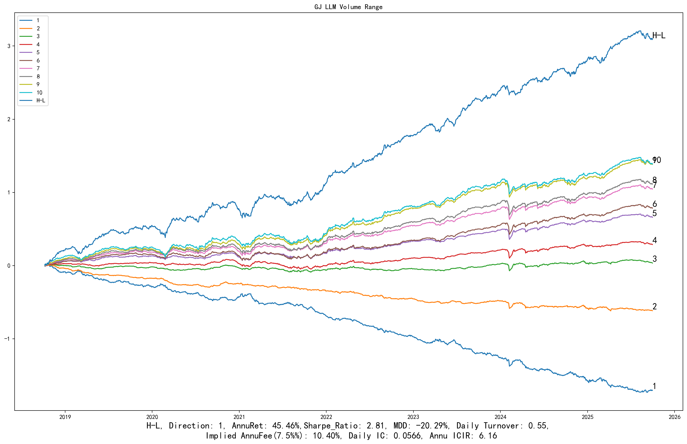

分组平均收益与相对回撤

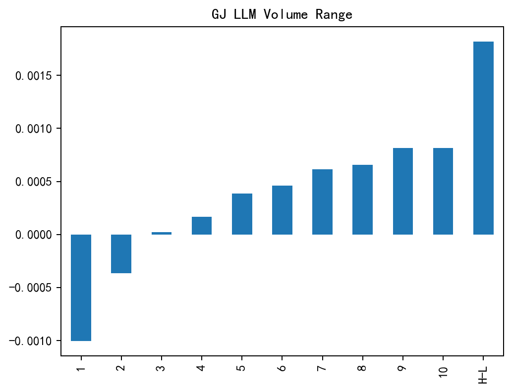

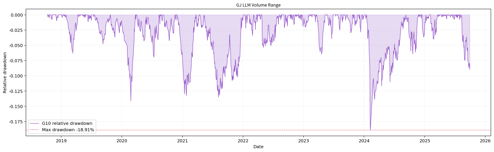

## Turnover Growth Stability

**研究对象：**研究交易活跃度的变化是否稳定，并区分换手水平、换手变化与风格暴露。展示的是从原始统计一次进行行业与规模联合中性化的版本。

| 股票范围 | 区间 | G10超额年化 | G10绝对Sharpe | H-L Sharpe | 日Rank IC |
| --- | --- | ---: | ---: | ---: | ---: |
| 历史合格沪深A股 | 2018-10-09—2025-09-30，1,698日 | **15.26%** | 1.06 | **4.42** | 0.0272 |

另外在2020-01-06—2025-09-30的严格同区间对照中，仅市值处理版本与行业规模联合处理版本的H-L Sharpe分别为3.00与4.16，G10超额年化分别为14.98%与15.41%。这说明研究不能只挑处理后最高的一个指标，也需要比较多头改善幅度。

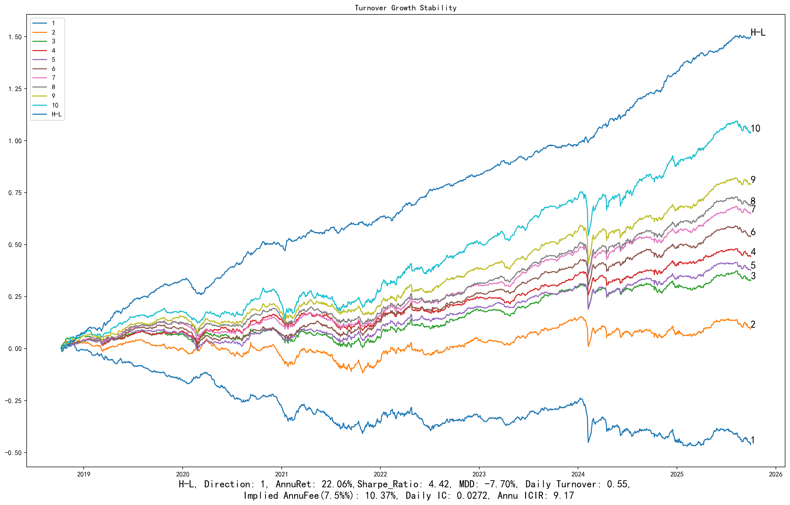

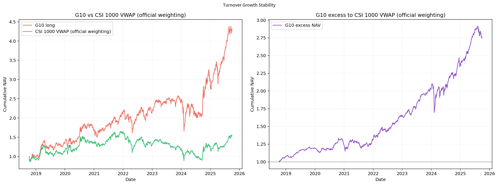

分组平均收益与相对回撤

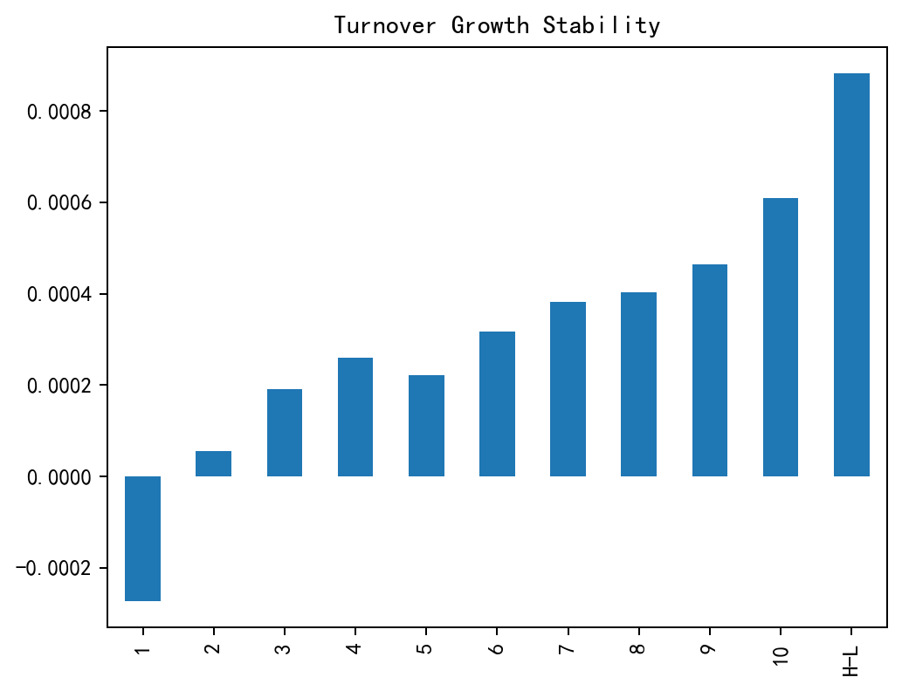

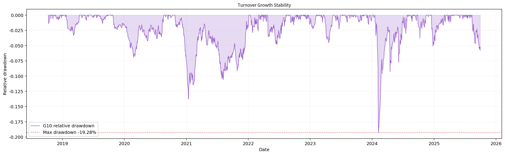

## Residual Non-Isolated Trade Imbalance

**研究对象：**从非孤立成交的买卖不平衡中识别行为信息，再研究规模与同期涨跌能否解释该信息。此处为日频信号与日频残差研究版本，不把原报告的月频结果混入本页。

| 股票范围 | 区间 | G10超额年化 | G10绝对Sharpe | H-L Sharpe | 日Rank IC | 超额最大回撤 |
| --- | --- | ---: | ---: | ---: | ---: | ---: |
| 中证1000历史成分股内 | 2018-10-17—2025-09-30，1,692日 | **13.76%** | **1.24** | 3.47 | 0.0168 | -8.99% |

这一案例体现逐笔数据语义、行为分类、残差化与可交易时间对齐的结合。残差针对指定变量，不能解释为已经去除所有风险暴露。

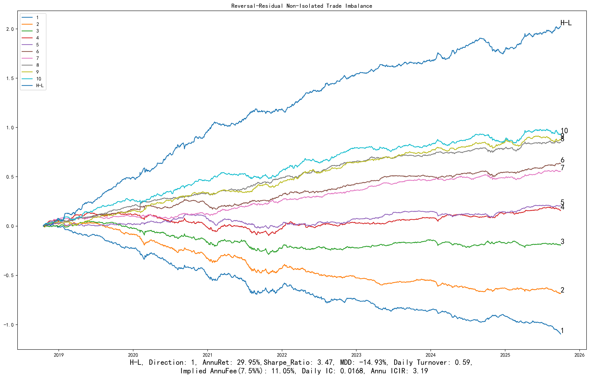

分组平均收益与相对回撤

## Analyst Co-Coverage Reversal

**研究对象：**用分析师直接共同覆盖关系组织可比股票，研究个股相对关联群体的价格反应。展示CF1直接关联分项的行业规模中性版本。

| 股票范围 | 区间 | G10超额年化 | G10绝对Sharpe | H-L Sharpe | 日Rank IC | 超额最大回撤 |
| --- | --- | ---: | ---: | ---: | ---: | ---: |
| 中证1000历史成分股内 | 2018-10-17—2025-09-30，1,692日 | **12.40%** | 0.97 | 2.48 | 0.0217 | -12.53% |

研究重点包括关系网络与价格信号更新的分离、覆盖样本偏差及历史可得性。本页结果属于当前选定历史版本；完整PIT、身份与修订历史仍需单独证据，不能由一张图认证。[研究说明](../factors/analyst-co-coverage-reversal.md)

分组平均收益与相对回撤

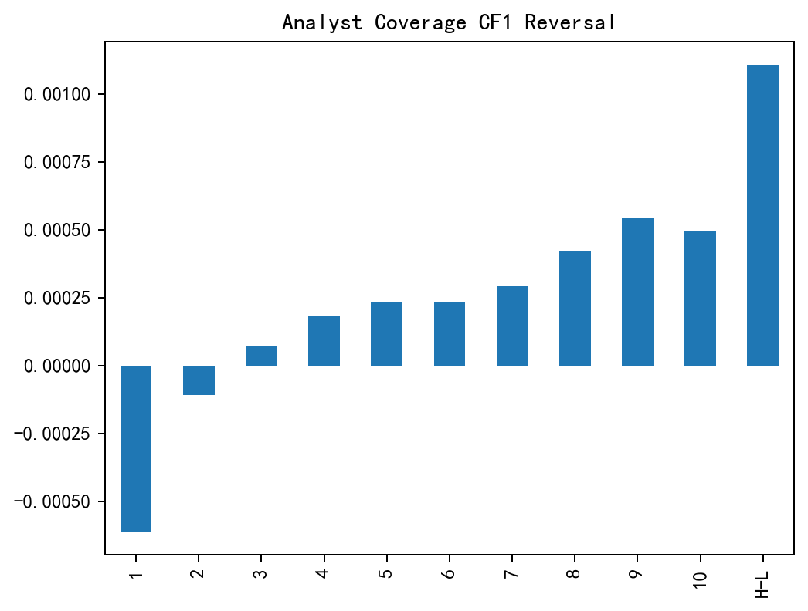

## Climb the Peak

**研究对象：**把局部波动状态的变化与跨日稳定性结合，研究价格路径中超出简单涨跌幅的信息。展示行业规模中性版本。

| 股票范围 | 区间 | G10超额年化 | G10绝对Sharpe | H-L Sharpe | 日Rank IC | 超额最大回撤 |
| --- | --- | ---: | ---: | ---: | ---: | ---: |
| 中证1000历史成分股内 | 2018-10-17—2025-09-30，1,692日 | **12.22%** | 1.04 | **4.40** | 0.0308 | **-8.35%** |

在同区间跨池实验中，该信号的H-L Sharpe在中证500内为1.60、沪深300内为1.00。它展示了较好的1000池排序表现，同时也提供了明确的泛化边界。

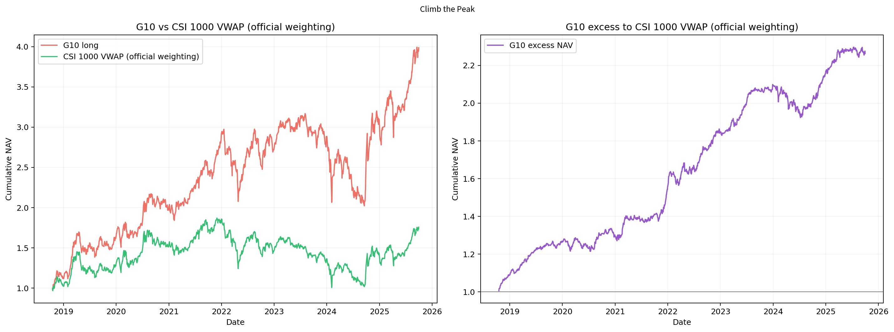

分组平均收益与相对回撤

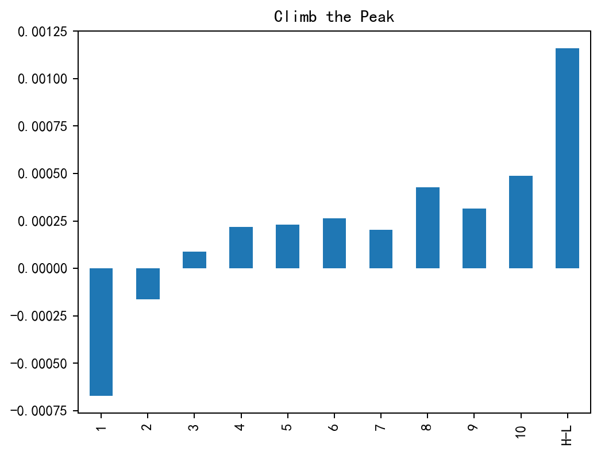

## Pre-Decline Turnover Signature

**研究对象：**共振研究中独立评估的下跌前成交特征分项。单项回放用于识别合成信号的收益来源，而不是用四分量组合的结果替代其中一项。

| 股票范围 | 区间 | G10超额年化 | G10绝对Sharpe | H-L Sharpe | 日Rank IC | 超额最大回撤 |
| --- | --- | ---: | ---: | ---: | ---: | ---: |
| 中证1000历史成分股内 | 2018-10-17—2025-09-30，1,692日 | **10.35%** | 1.04 | **4.33** | **0.0369** | -11.46% |

图中部分高分组存在交叉，G10并非每段时间或每项指标都优于所有中间组。研究中会把分层、组间单调性与长端收益分别评估。

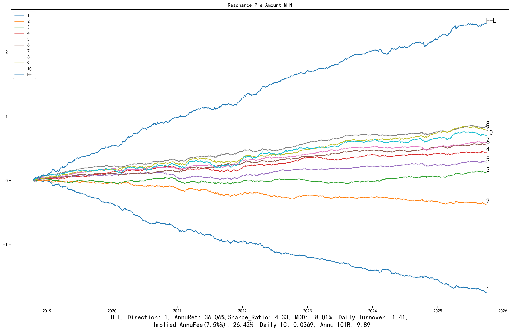

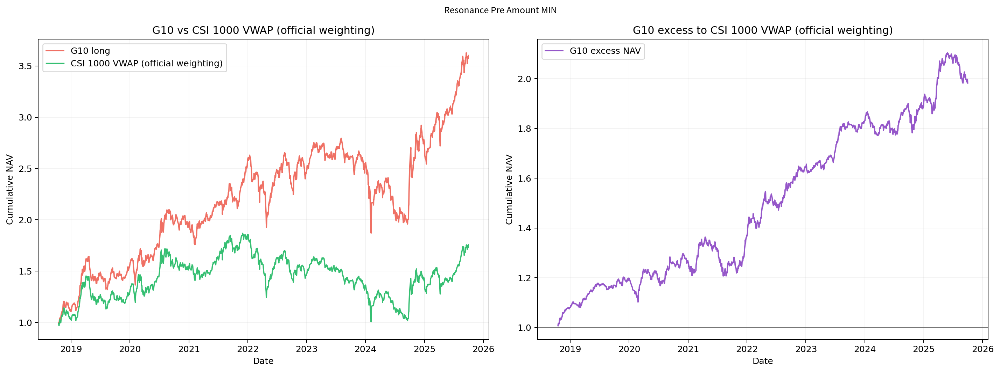

分组平均收益与相对回撤

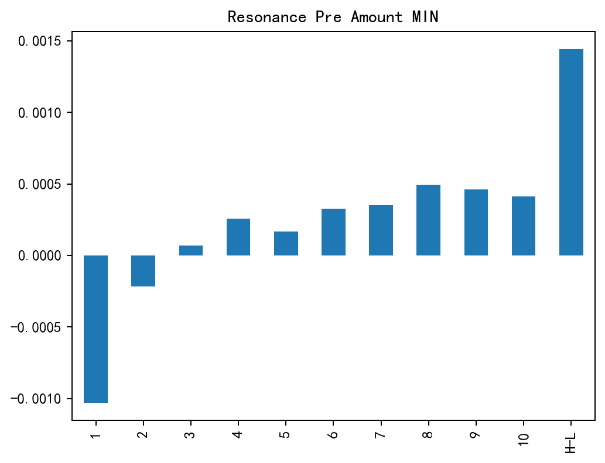

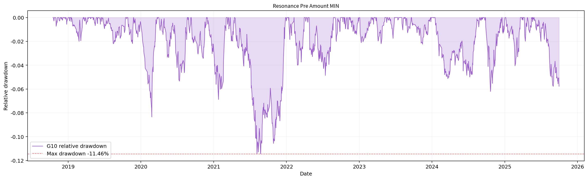

## 结果范围与后续验证

这些案例用于展示研究能力与实验结果，不代表全部尝试、策略组合收益或独立Alpha数量。较好结果经过历史筛选；下一步仍需冻结版本后的前瞻检验、成本敏感性、容量与实际成交约束。

指数内实验使用同一信号构造，仅改变最终投资资格。有效股票数随覆盖、预热和交易过滤变化；分析师关系因子只覆盖具备有效关系数据的子集，不能将“1000池”理解成每日都能对1000只股票有效打分。

[返回首页](../../README.md) · [研究覆盖与拓展](../research-scope.md) · [公开范围](../disclosure.md)

> **2026-10-27更新：[十个因子 × 1000／500／300的30组回测、120张原始图](ten/README.md)已补齐。** 本页继续保留原六个精选案例，部分全A版本与新三池版本不同，具体区别在新页说明。
