# Analyst Co-Coverage Reversal

分析师共同覆盖改进反转。 CF1直接关联分项，行业＋规模中性。关系网络更新与每日价格信号更新不同；此处不把每日记账当成关系网络每日重建，也不将完整PIT认证归因于图表。

**历史毛收益，未扣交易成本；回顾性研究结果，不是独立盲测或实盘。** 三池共同使用中证1000官方历史权重的日VWAP研究基准，500/300的超额不是相对自身指数。

[因子介绍](../../factors/analyst-co-coverage-reversal.md) · [十因子总表](README.md) · [统一口径](README.md#evaluation-conventions)

| 历史投资池 | 实际日期／日数 | G10绝对年化 | G10超额年化 | G10绝对Sharpe | H-L Sharpe | 日Rank IC | G10超额最大回撤 |
|---|---|---:|---:|---:|---:|---:|---:|
| 中证1000 | 2018-10-17—2025-09-30 / 1692 | 23.01% | 12.40% | 0.972 | 2.480 | 0.0217 | -12.53% |
| 中证500 | 2018-10-17—2025-09-30 / 1692 | 20.31% | 9.70% | 0.929 | 1.639 | 0.0133 | -12.47% |
| 沪深300 | 2018-10-17—2025-09-30 / 1692 | 16.98% | 6.36% | 0.812 | 0.985 | 0.0105 | -25.41% |

## CSI1000

中证1000历史成分股内选股，四张图来自同一版本、同一股票池。

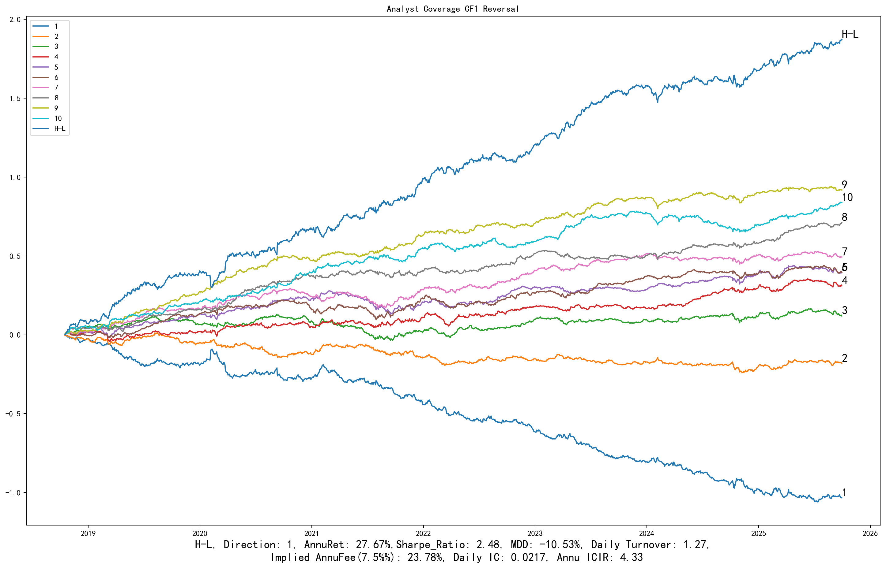

展开：分组平均收益、G10与基准、相对回撤

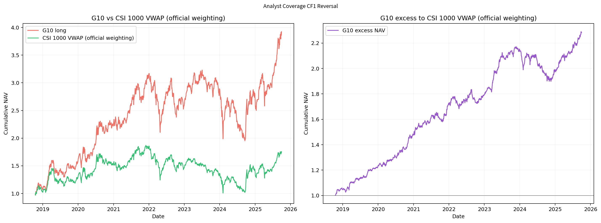

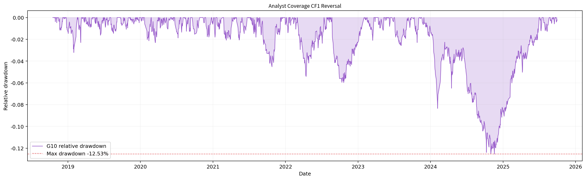

## CSI500

中证500历史成分股内选股，四张图来自同一版本、同一股票池。

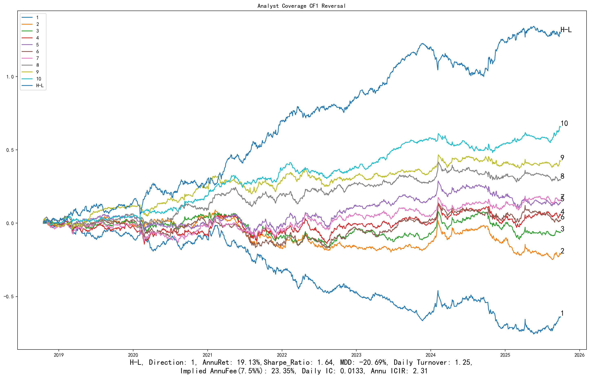

展开：分组平均收益、G10与基准、相对回撤

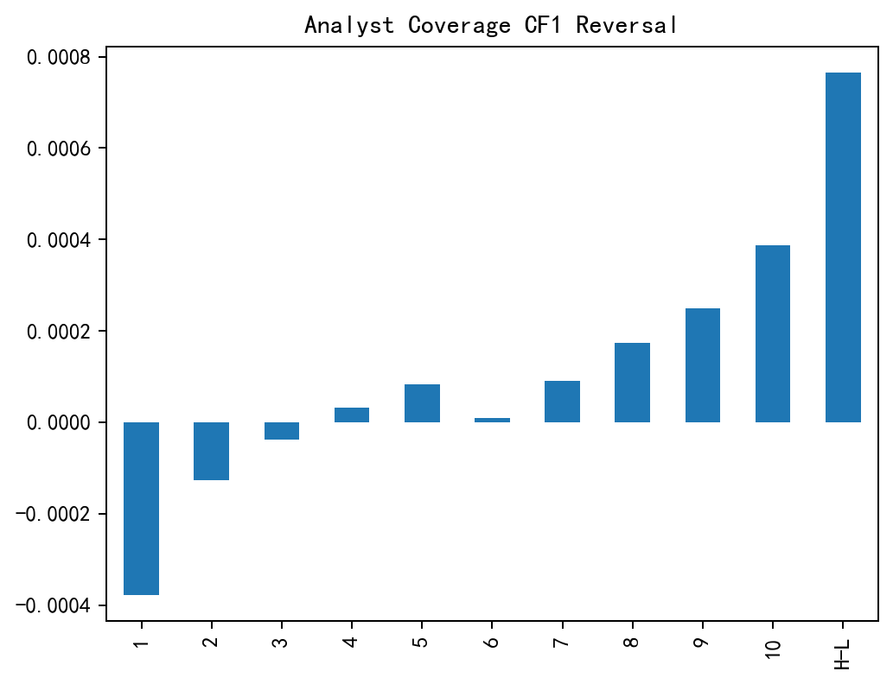

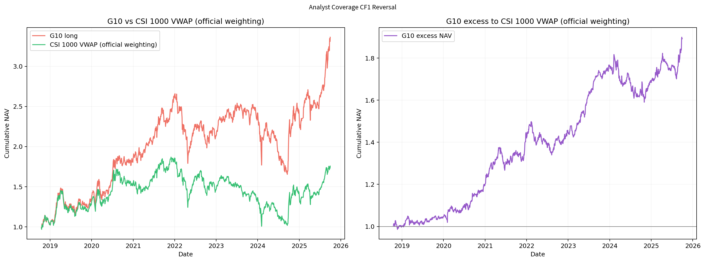

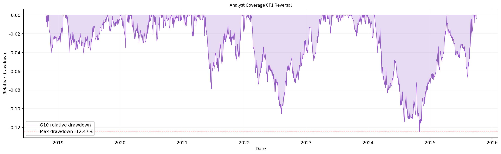

## CSI300

沪深300历史成分股内选股，四张图来自同一版本、同一股票池。

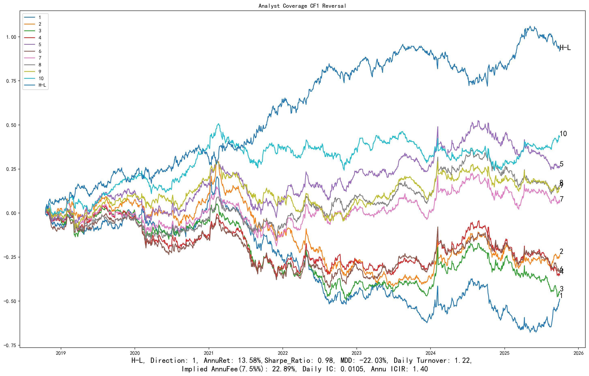

展开：分组平均收益、G10与基准、相对回撤

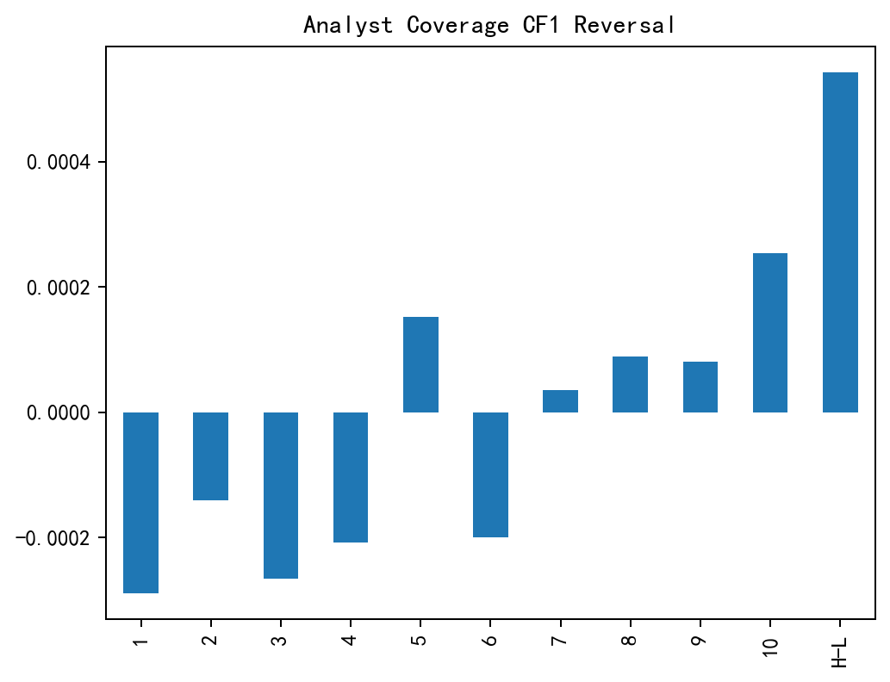

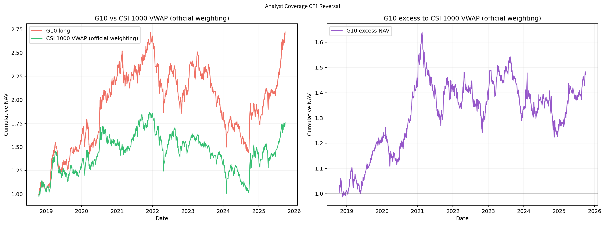

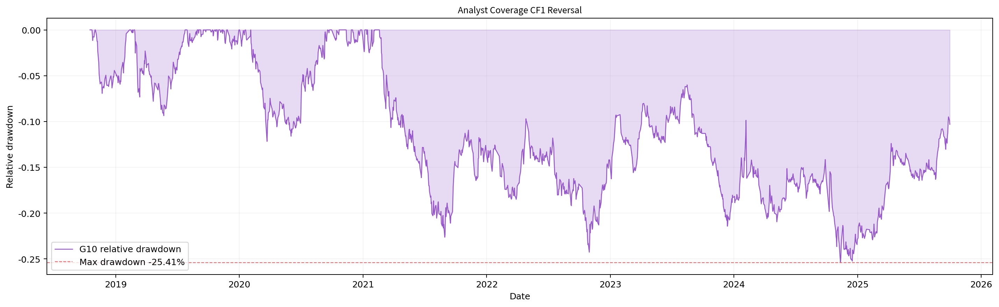

[返回十因子总表](README.md) · [返回主页](../../../README.md)
