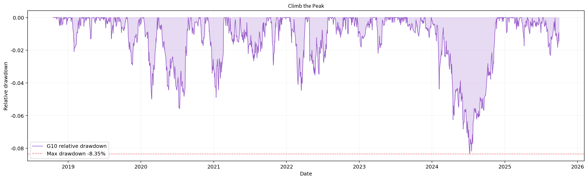
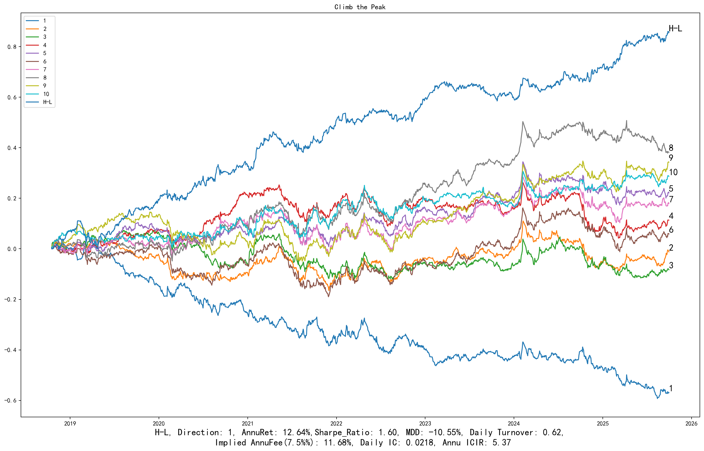
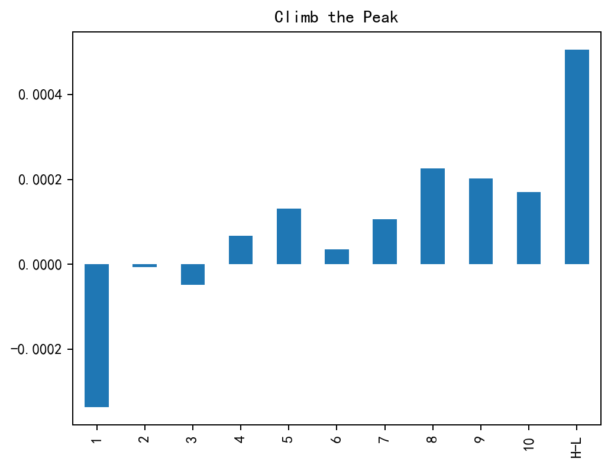
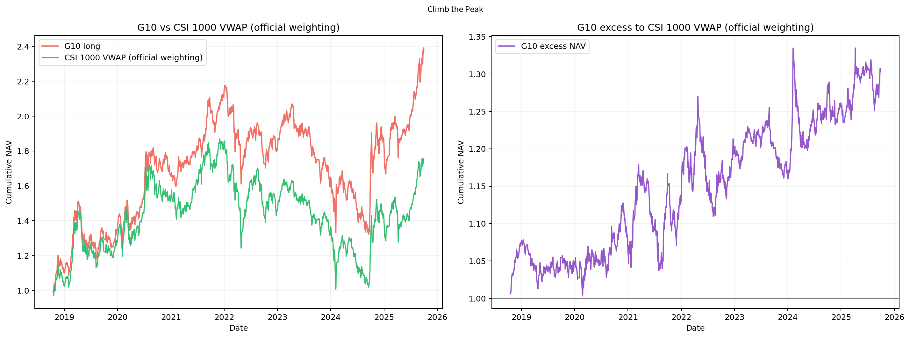
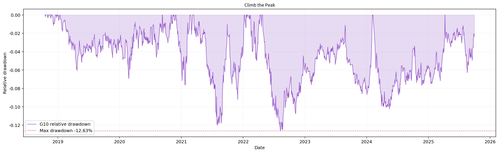
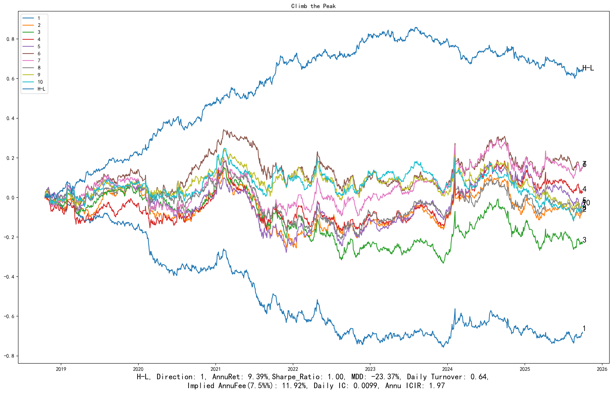
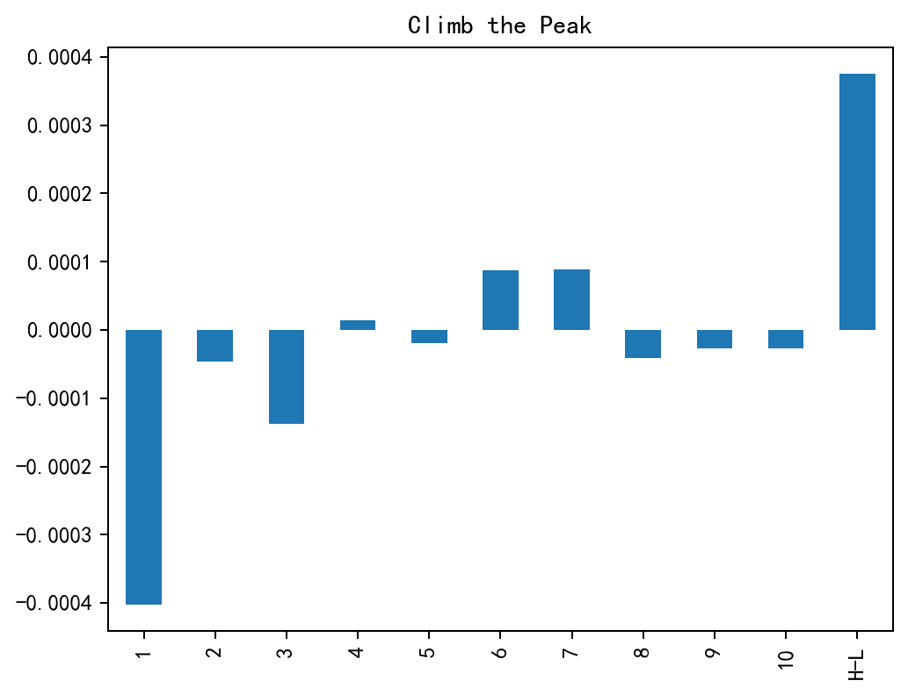
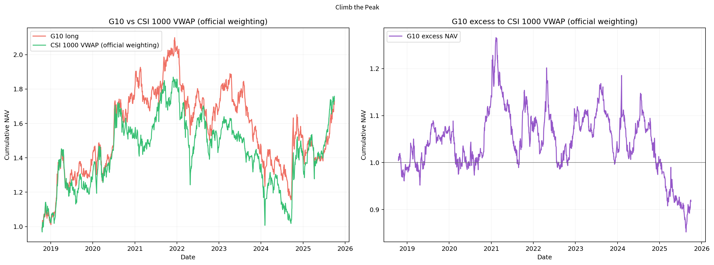
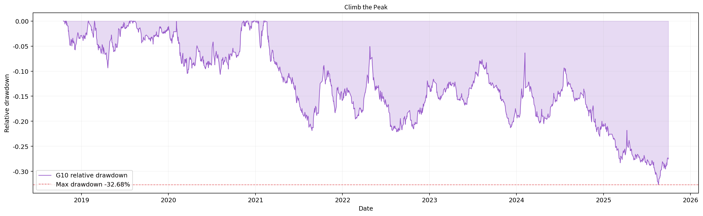

# Climb the Peak

勇攀高峰。 行业＋规模中性版本。

**历史毛收益，未扣交易成本；回顾性研究结果，不是独立盲测或实盘。** 三池共同使用中证1000官方历史权重的日VWAP研究基准，500/300的超额不是相对自身指数。

[因子介绍](../../factors/climb-the-peak.md) · [十因子总表](README.md) · [统一口径](README.md#evaluation-conventions)

| 历史投资池 | 实际日期／日数 | G10绝对年化 | G10超额年化 | G10绝对Sharpe | H-L Sharpe | 日Rank IC | G10超额最大回撤 |
|---|---|---:|---:|---:|---:|---:|---:|
| 中证1000 | 2018-10-17—2025-09-30 / 1692 | 22.84% | 12.22% | 1.042 | 4.395 | 0.0308 | -8.35% |
| 中证500 | 2018-10-17—2025-09-30 / 1692 | 14.85% | 4.24% | 0.747 | 1.597 | 0.0218 | -12.63% |
| 沪深300 | 2018-10-17—2025-09-30 / 1692 | 9.94% | -0.67% | 0.519 | 1.003 | 0.0099 | -32.68% |

## CSI1000

中证1000历史成分股内选股，四张图来自同一版本、同一股票池。

展开：分组平均收益、G10与基准、相对回撤

## CSI500

中证500历史成分股内选股，四张图来自同一版本、同一股票池。

展开：分组平均收益、G10与基准、相对回撤

## CSI300

沪深300历史成分股内选股，四张图来自同一版本、同一股票池。

展开：分组平均收益、G10与基准、相对回撤

[返回十因子总表](README.md) · [返回主页](../../../README.md)
