# Information Distribution Uniformity

信息分布均匀度。 行业＋规模中性版本。

**历史毛收益，未扣交易成本；回顾性研究结果，不是独立盲测或实盘。** 三池共同使用中证1000官方历史权重的日VWAP研究基准，500/300的超额不是相对自身指数。

[因子介绍](../../factors/information-distribution-uniformity.md) · [十因子总表](README.md) · [统一口径](README.md#evaluation-conventions)

| 历史投资池 | 实际日期／日数 | G10绝对年化 | G10超额年化 | G10绝对Sharpe | H-L Sharpe | 日Rank IC | G10超额最大回撤 |
|---|---|---:|---:|---:|---:|---:|---:|
| 中证1000 | 2018-10-17—2025-09-30 / 1692 | 24.02% | 13.40% | 1.233 | 2.999 | 0.0425 | -14.46% |
| 中证500 | 2018-10-17—2025-09-30 / 1692 | 15.05% | 4.43% | 0.843 | 1.215 | 0.0315 | -22.15% |
| 沪深300 | 2018-10-17—2025-09-30 / 1692 | 11.44% | 0.82% | 0.814 | 0.724 | 0.0256 | -34.48% |

## CSI1000

中证1000历史成分股内选股，四张图来自同一版本、同一股票池。

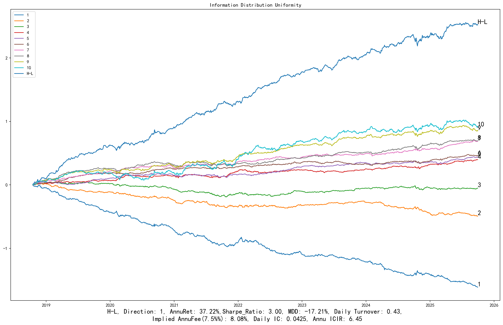

展开：分组平均收益、G10与基准、相对回撤

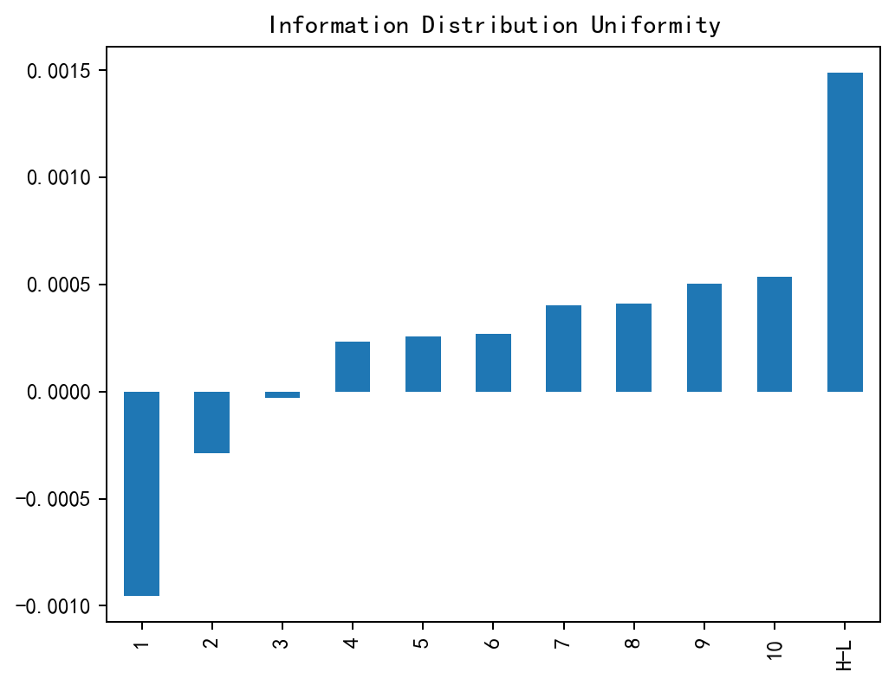

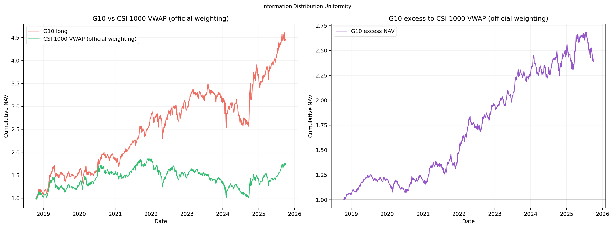

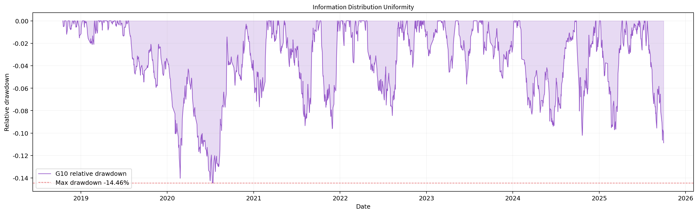

## CSI500

中证500历史成分股内选股，四张图来自同一版本、同一股票池。

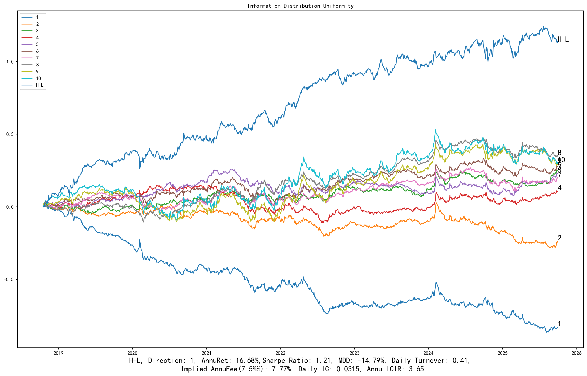

展开：分组平均收益、G10与基准、相对回撤

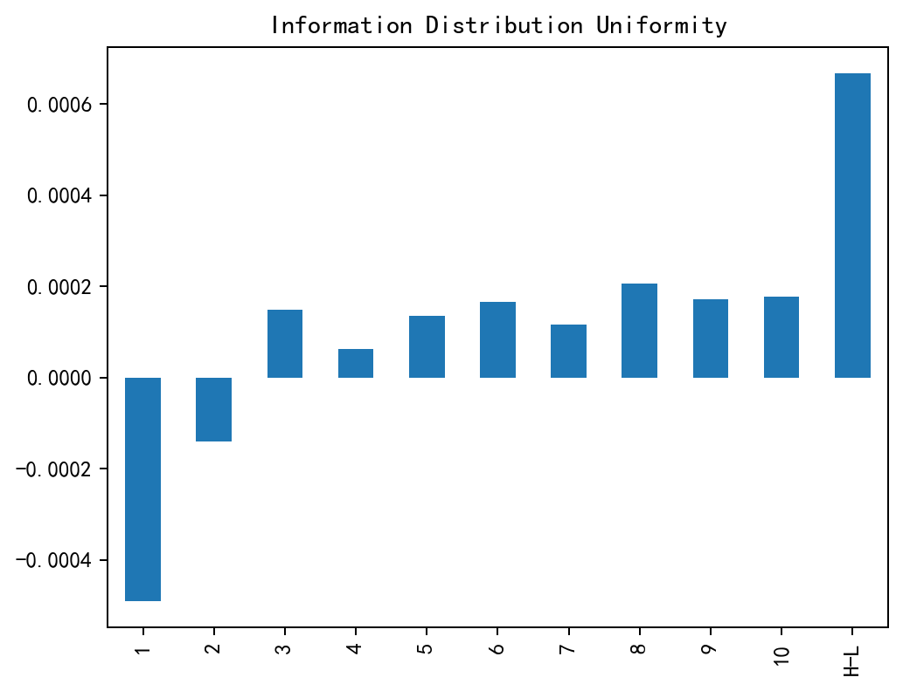

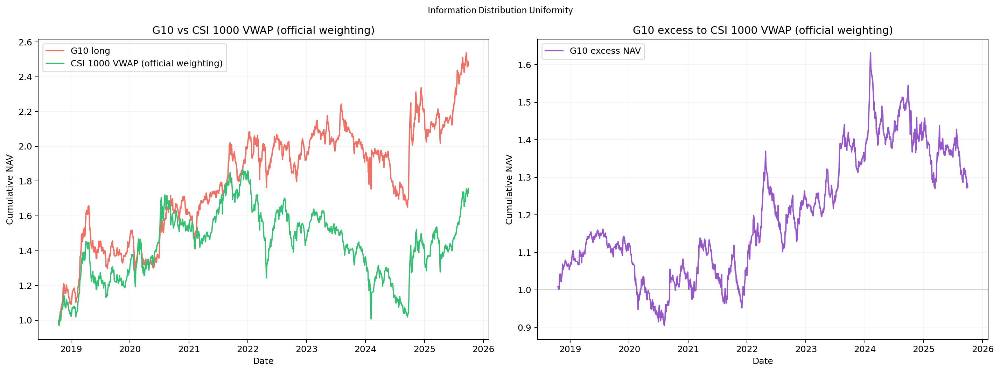

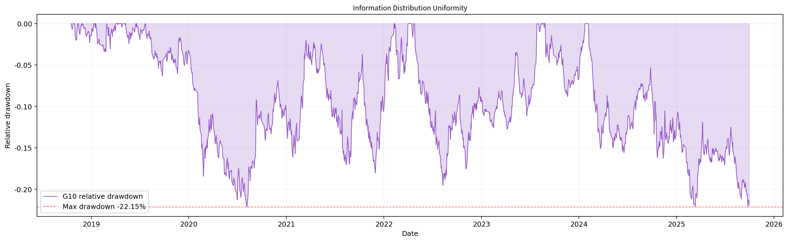

## CSI300

沪深300历史成分股内选股，四张图来自同一版本、同一股票池。

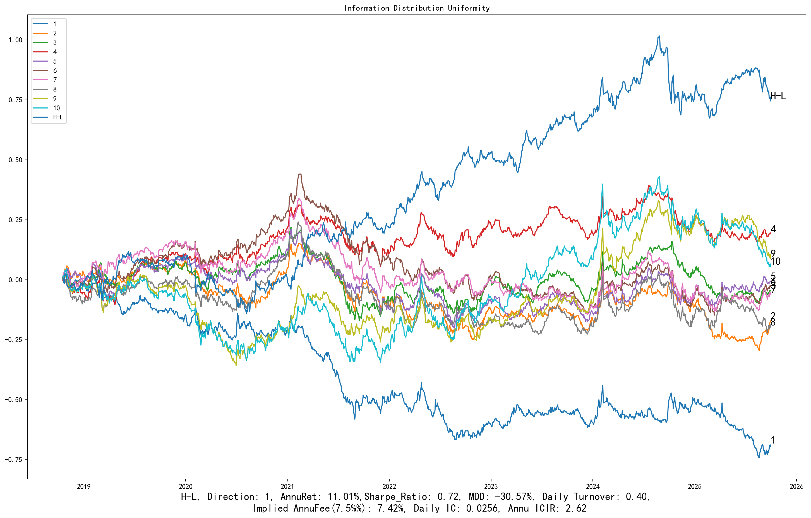

展开：分组平均收益、G10与基准、相对回撤

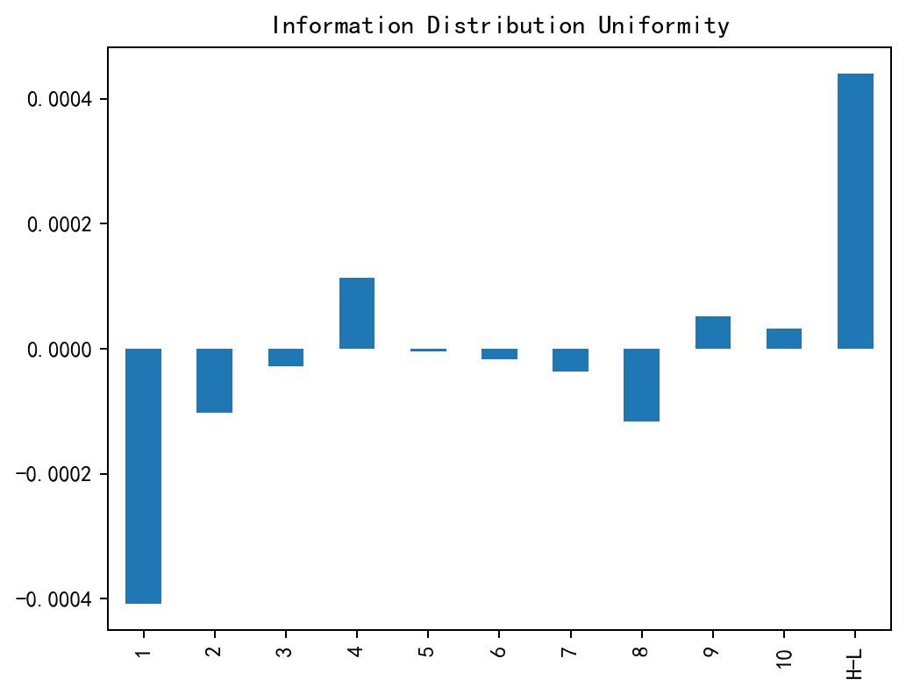

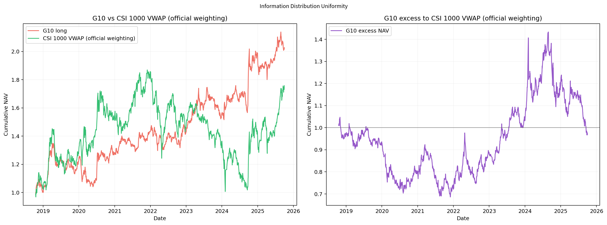

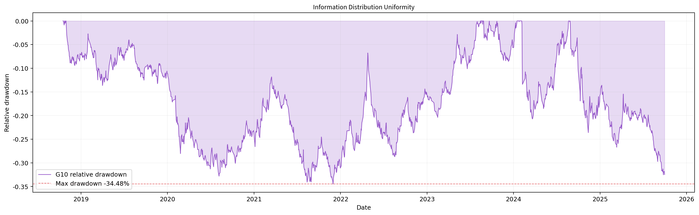

[返回十因子总表](README.md) · [返回主页](../../../README.md)
