# Regret-Aversion Buying Volume

高于收盘价主动买量占比。 原始主动买量比例核心版本，没有追加行业市值处理。不同池Rank IC较低且换手较高，应将长端、分层与成本分别审视；不能从毛收益证明净收益有效。

**历史毛收益，未扣交易成本；回顾性研究结果，不是独立盲测或实盘。** 三池共同使用中证1000官方历史权重的日VWAP研究基准，500/300的超额不是相对自身指数。

[因子介绍](../../factors/regret-aversion-buying-volume.md) · [十因子总表](README.md) · [统一口径](README.md#evaluation-conventions)

| 历史投资池 | 实际日期／日数 | G10绝对年化 | G10超额年化 | G10绝对Sharpe | H-L Sharpe | 日Rank IC | G10超额最大回撤 |
|---|---|---:|---:|---:|---:|---:|---:|
| 中证1000 | 2018-10-08—2025-09-30 / 1699 | 12.10% | 3.58% | 0.544 | 1.618 | 0.0011 | -12.12% |
| 中证500 | 2018-10-08—2025-09-30 / 1699 | 12.21% | 3.69% | 0.619 | 1.373 | 0.0033 | -20.18% |
| 沪深300 | 2018-10-08—2025-09-30 / 1699 | 13.93% | 5.40% | 0.746 | 1.665 | 0.0084 | -29.39% |

## CSI1000

中证1000历史成分股内选股，四张图来自同一版本、同一股票池。

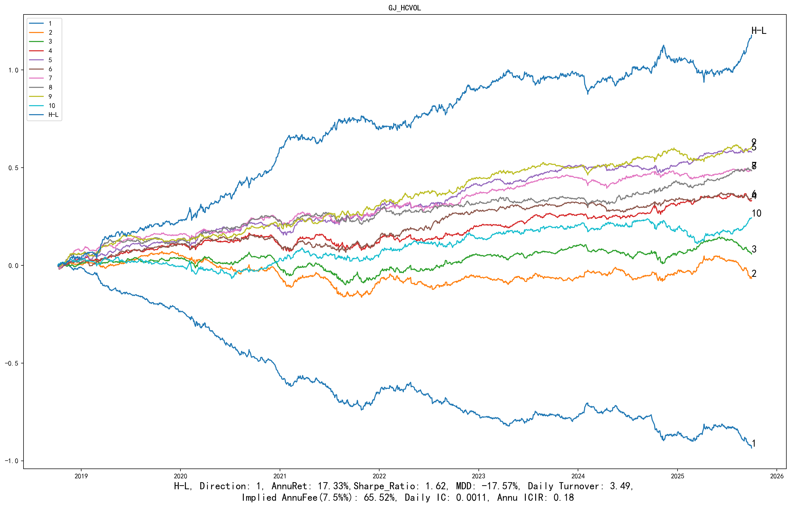

展开：分组平均收益、G10与基准、相对回撤

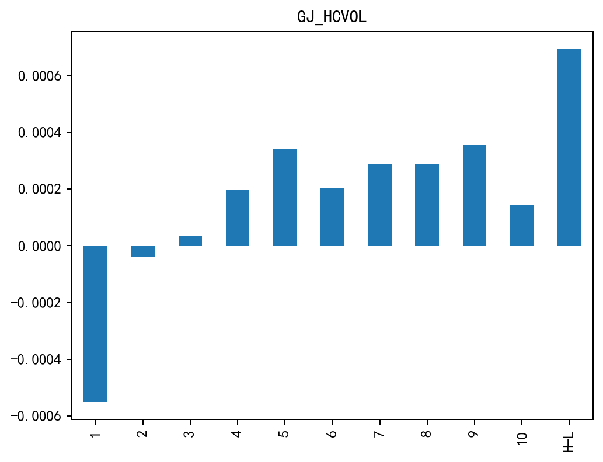

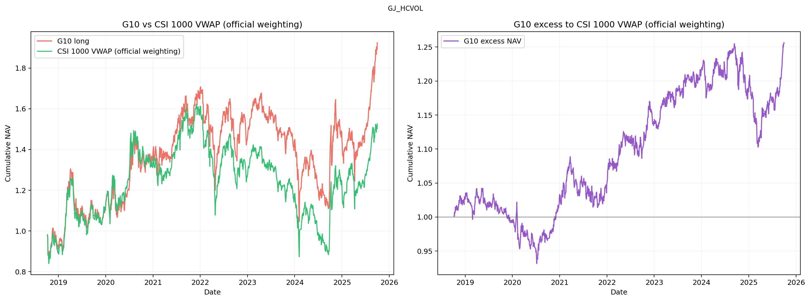

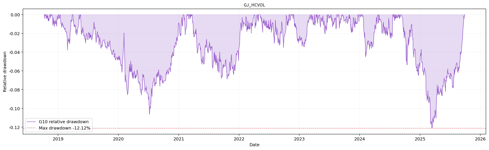

## CSI500

中证500历史成分股内选股，四张图来自同一版本、同一股票池。

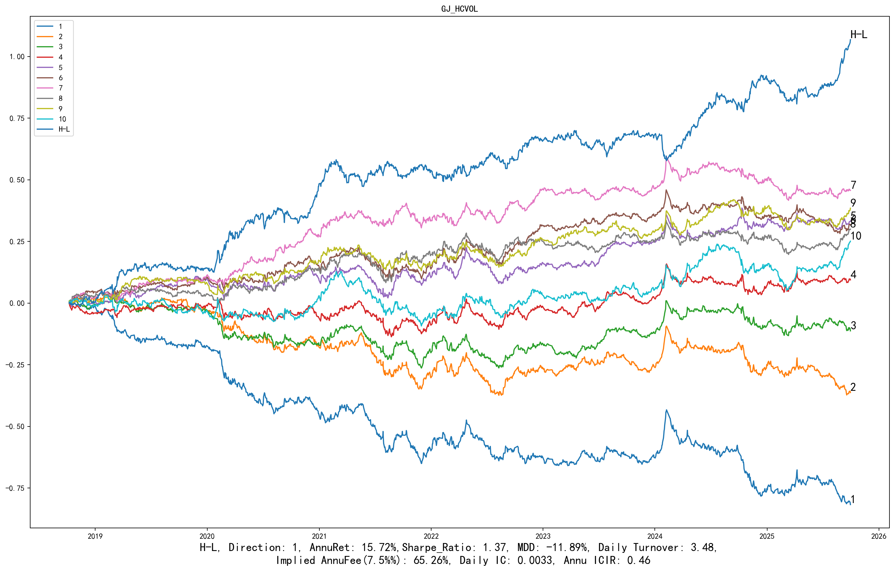

展开：分组平均收益、G10与基准、相对回撤

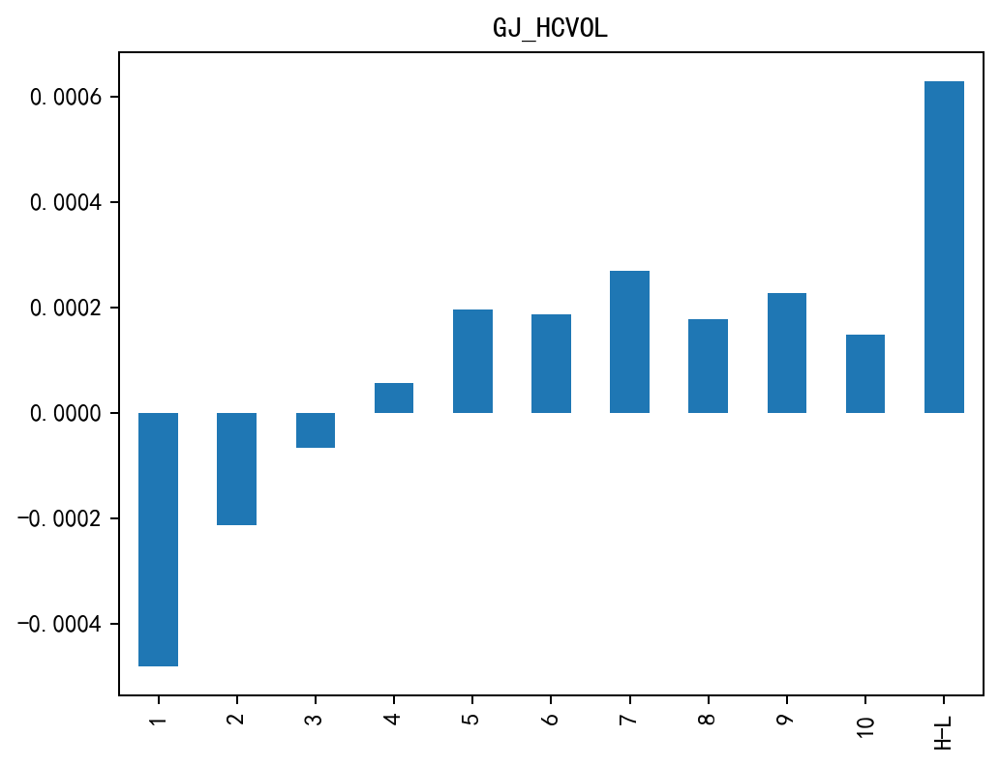

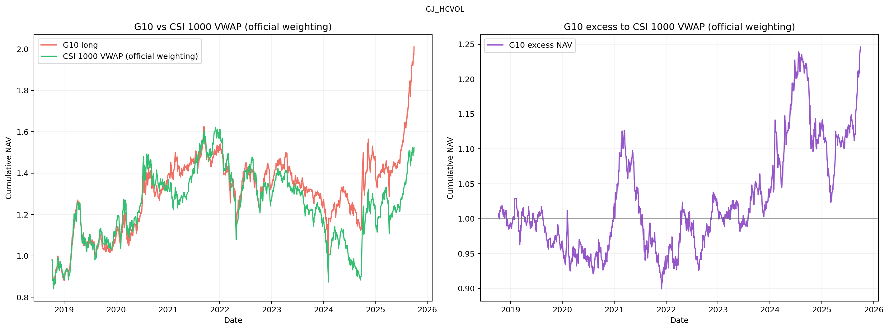

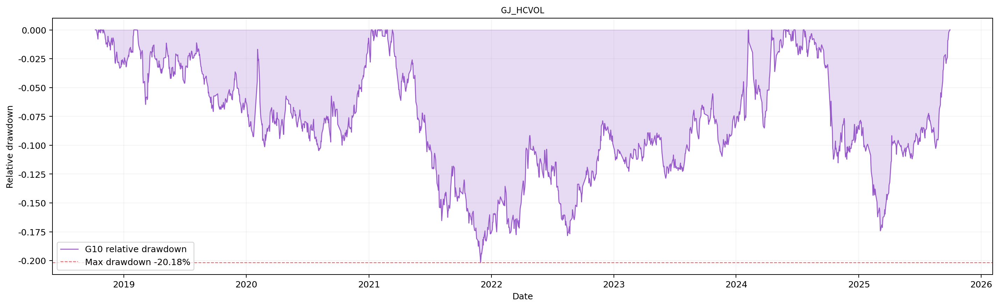

## CSI300

沪深300历史成分股内选股，四张图来自同一版本、同一股票池。

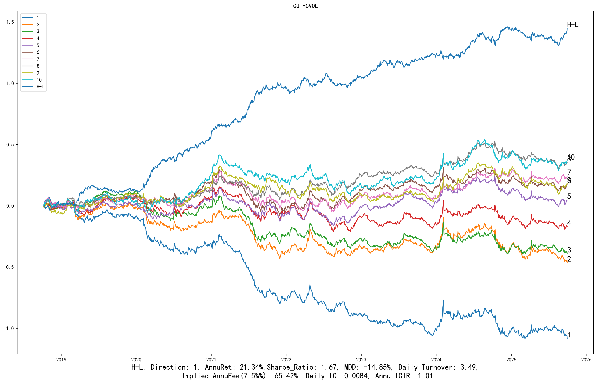

展开：分组平均收益、G10与基准、相对回撤

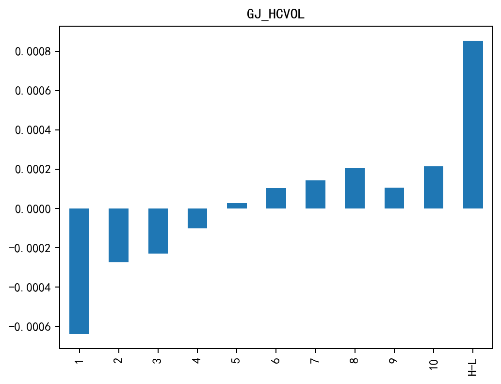

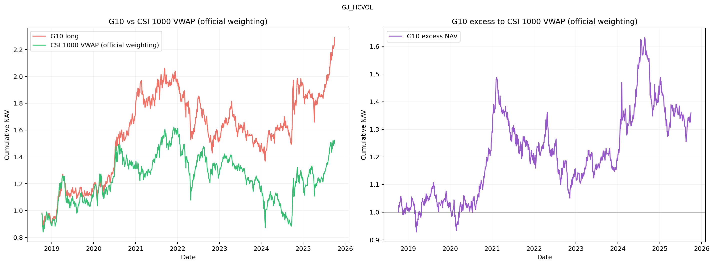

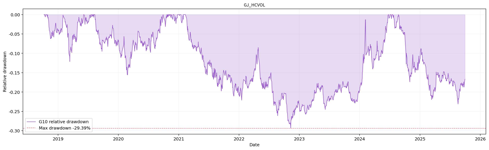

[返回十因子总表](README.md) · [返回主页](../../../README.md)
