# Residual Non-Isolated Trade Imbalance

反转残差非孤立成交不平衡。 每日信号研究版，保留市值及同期收益残差处理；不是原研报月末信号版本，也不是行业＋规模中性版本。

**历史毛收益，未扣交易成本；回顾性研究结果，不是独立盲测或实盘。** 三池共同使用中证1000官方历史权重的日VWAP研究基准，500/300的超额不是相对自身指数。

[因子介绍](../../factors/residual-non-isolated-trade-imbalance.md) · [十因子总表](README.md) · [统一口径](README.md#evaluation-conventions)

| 历史投资池 | 实际日期／日数 | G10绝对年化 | G10超额年化 | G10绝对Sharpe | H-L Sharpe | 日Rank IC | G10超额最大回撤 |
|---|---|---:|---:|---:|---:|---:|---:|
| 中证1000 | 2018-10-17—2025-09-30 / 1692 | 24.38% | 13.76% | 1.243 | 3.474 | 0.0168 | -8.99% |
| 中证500 | 2018-10-17—2025-09-30 / 1692 | 17.23% | 6.62% | 0.972 | 1.689 | 0.0107 | -19.88% |
| 沪深300 | 2018-10-17—2025-09-30 / 1692 | 15.04% | 4.43% | 0.911 | 1.421 | 0.0110 | -35.67% |

## CSI1000

中证1000历史成分股内选股，四张图来自同一版本、同一股票池。

展开：分组平均收益、G10与基准、相对回撤

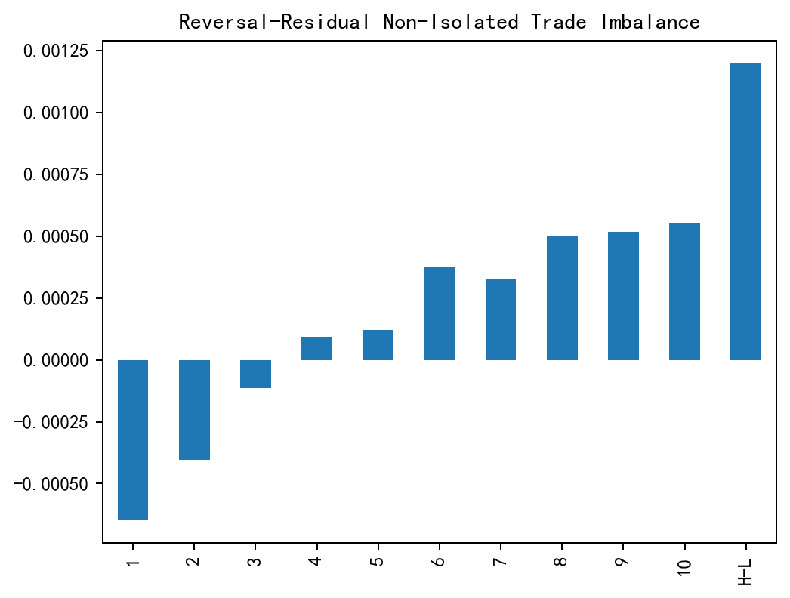

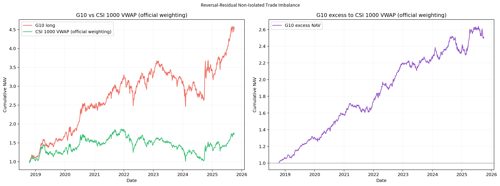

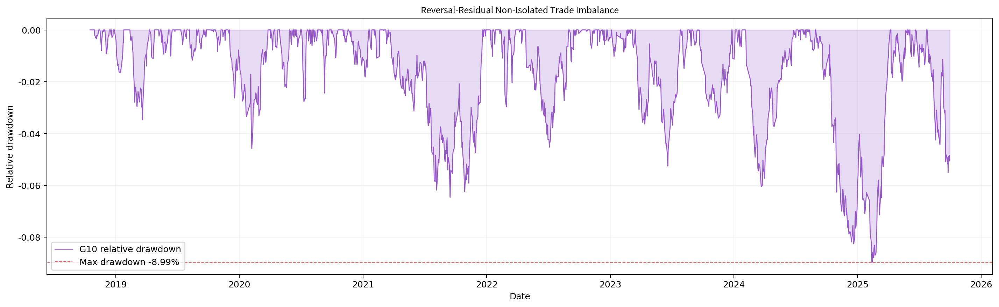

## CSI500

中证500历史成分股内选股，四张图来自同一版本、同一股票池。

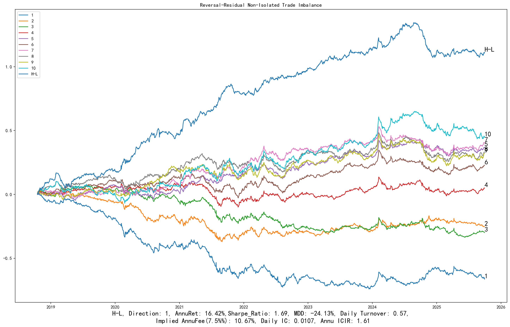

展开：分组平均收益、G10与基准、相对回撤

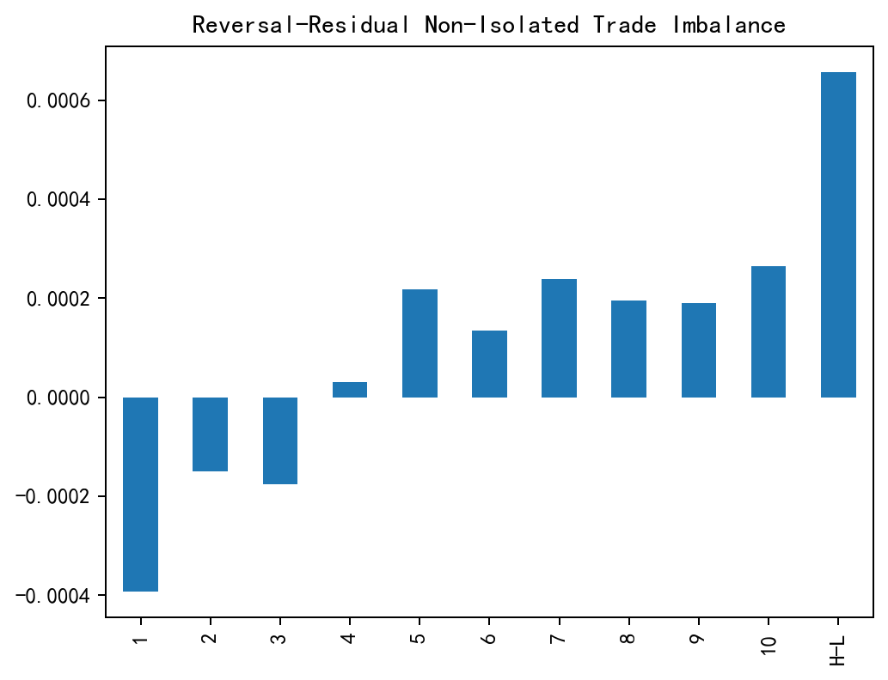

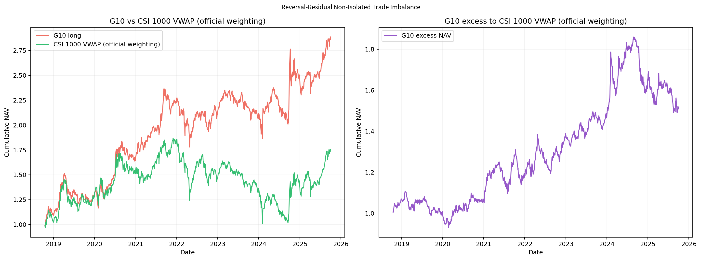

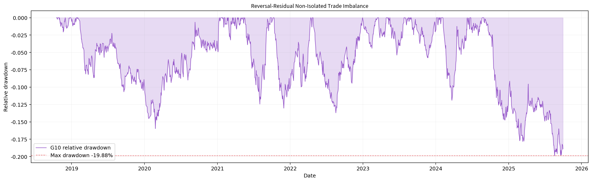

## CSI300

沪深300历史成分股内选股，四张图来自同一版本、同一股票池。

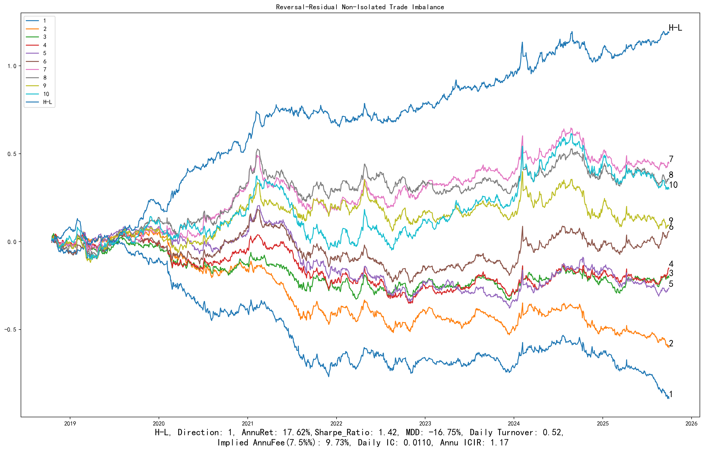

展开：分组平均收益、G10与基准、相对回撤

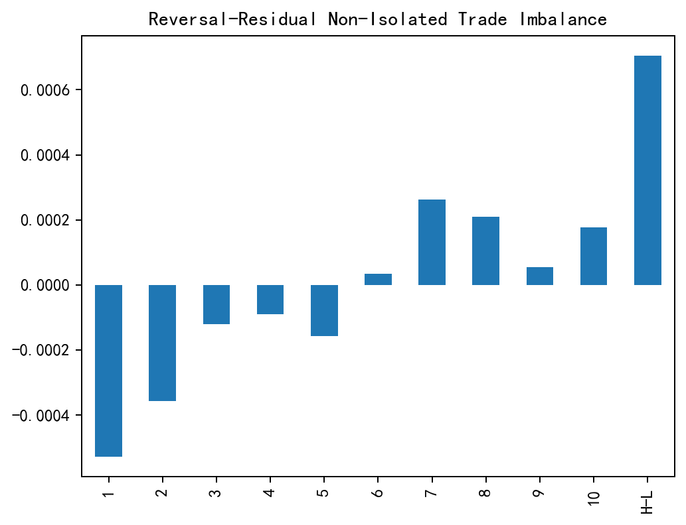

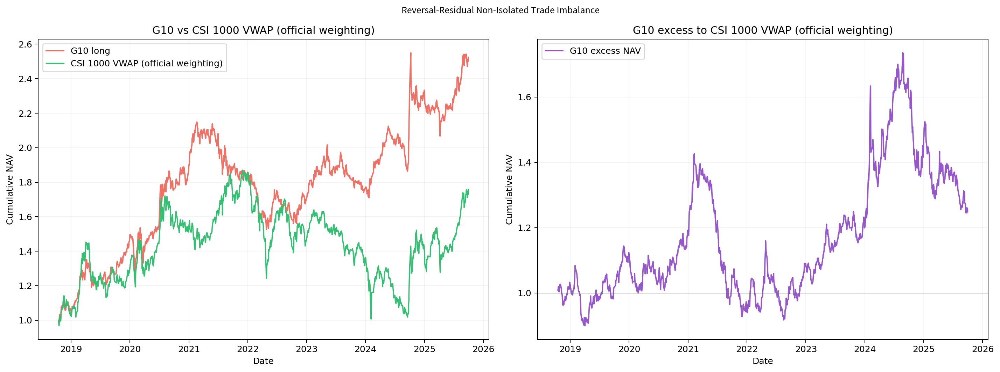

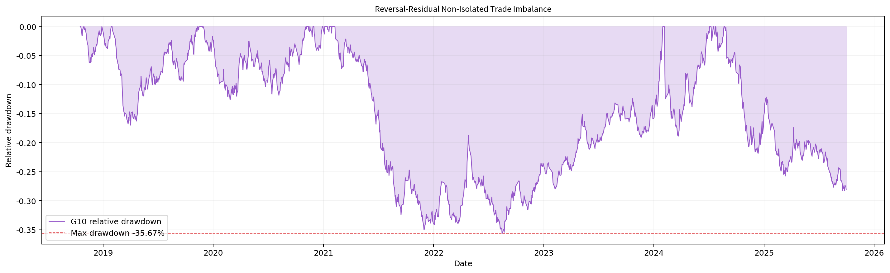

[返回十因子总表](README.md) · [返回主页](../../../README.md)
