# Turnover Growth Stability

换手率变化稳定性。 本页三池均为仅规模处理版本，2020-01-06起。旧精选图集中的全A图为行业＋规模中性版本，且区间更长；两者不是只改变股票池的同版本对照。

**历史毛收益，未扣交易成本；回顾性研究结果，不是独立盲测或实盘。** 三池共同使用中证1000官方历史权重的日VWAP研究基准，500/300的超额不是相对自身指数。

[因子介绍](../../factors/turnover-growth-stability.md) · [十因子总表](README.md) · [统一口径](README.md#evaluation-conventions)

| 历史投资池 | 实际日期／日数 | G10绝对年化 | G10超额年化 | G10绝对Sharpe | H-L Sharpe | 日Rank IC | G10超额最大回撤 |
|---|---|---:|---:|---:|---:|---:|---:|
| 中证1000 | 2020-01-06—2025-09-30 / 1393 | 14.07% | 6.71% | 0.632 | 1.461 | 0.0234 | -13.19% |
| 中证500 | 2020-01-06—2025-09-30 / 1393 | 10.03% | 2.67% | 0.508 | 0.201 | 0.0156 | -19.18% |
| 沪深300 | 2020-01-06—2025-09-30 / 1393 | -1.42% | -8.77% | -0.081 | -0.764 | 0.0111 | -48.10% |

## CSI1000

中证1000历史成分股内选股，四张图来自同一版本、同一股票池。

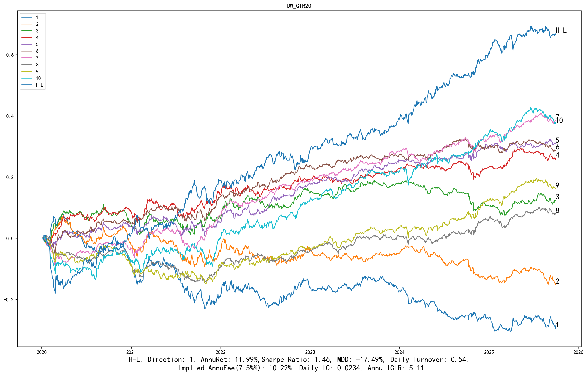

展开：分组平均收益、G10与基准、相对回撤

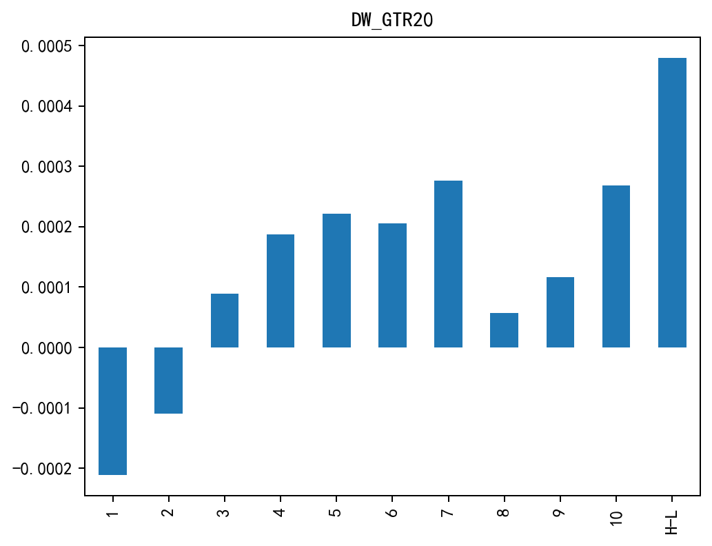

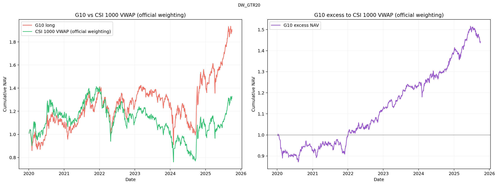

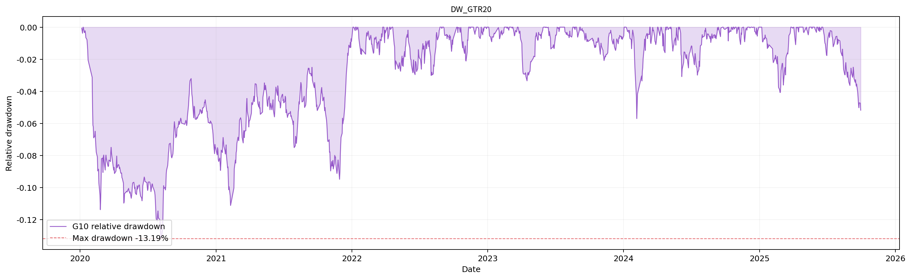

## CSI500

中证500历史成分股内选股，四张图来自同一版本、同一股票池。

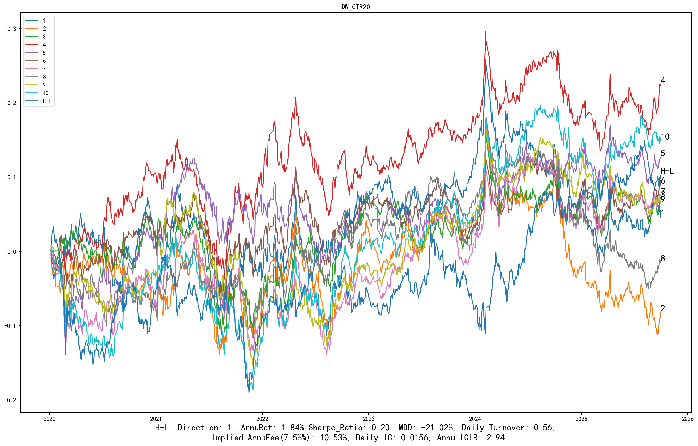

展开：分组平均收益、G10与基准、相对回撤

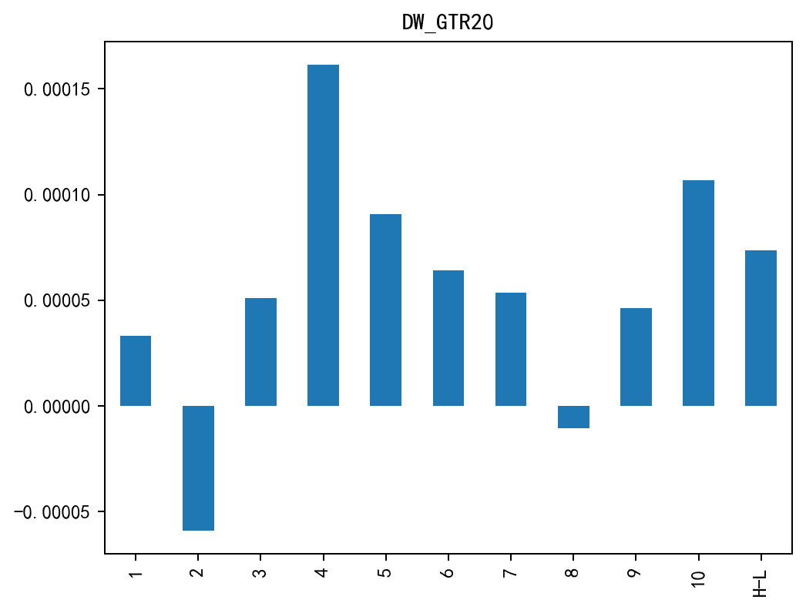

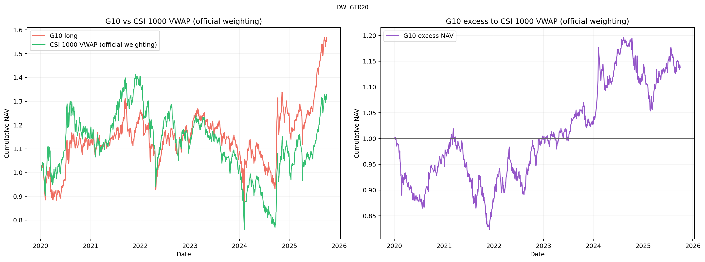

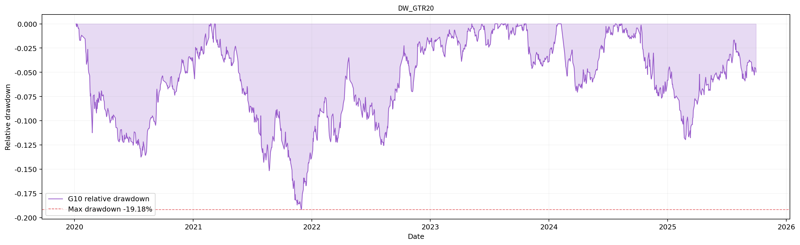

## CSI300

沪深300历史成分股内选股，四张图来自同一版本、同一股票池。

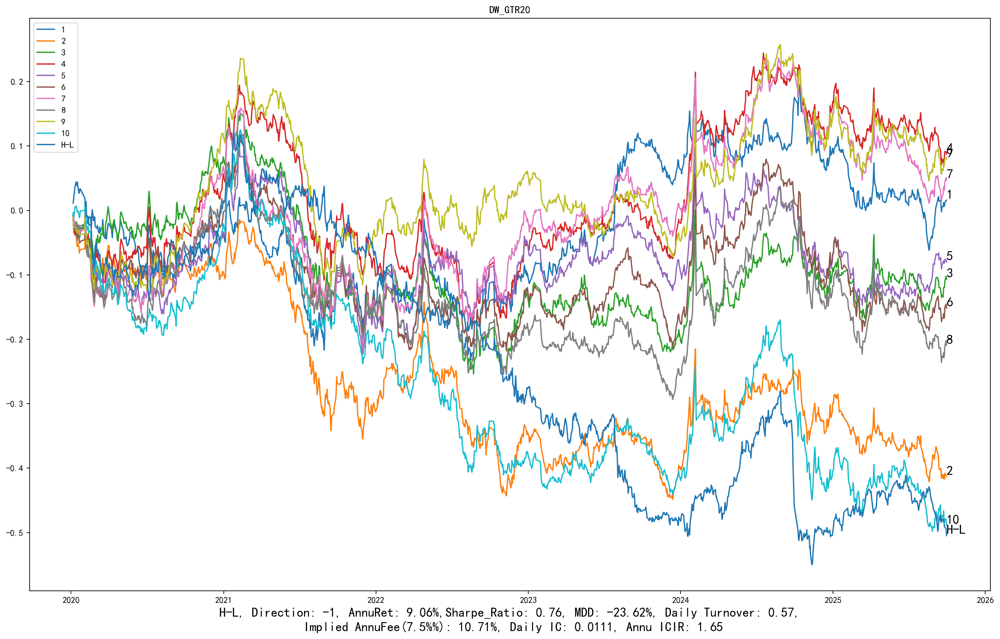

展开：分组平均收益、G10与基准、相对回撤

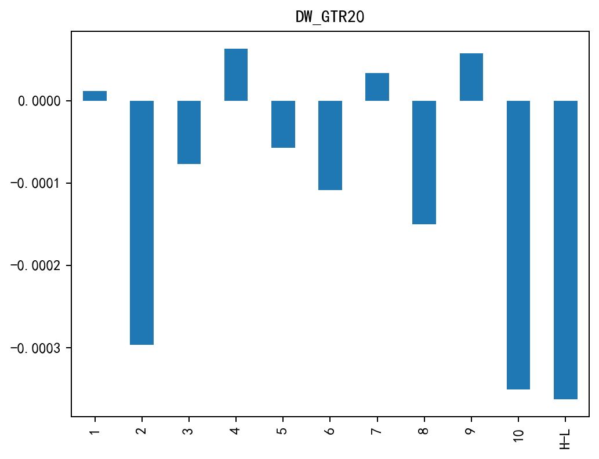

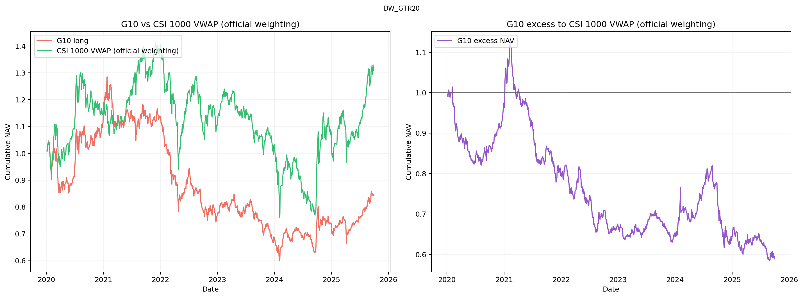

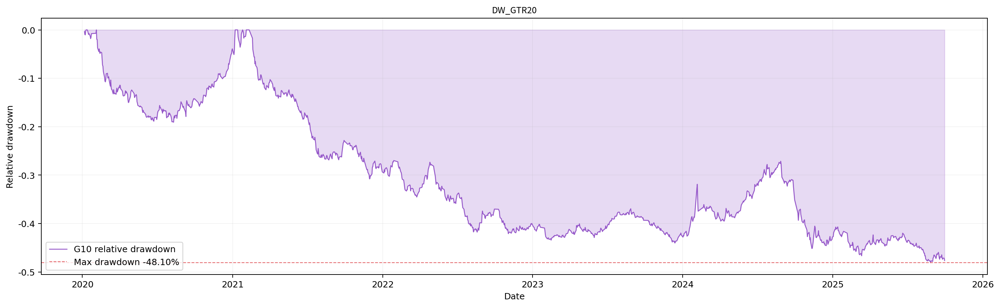

[返回十因子总表](README.md) · [返回主页](../../../README.md)
