# Upward Price Resonance

上涨价变共振分项。 共振研究的上涨方向独立分项，不是四分量合成信号。

**历史毛收益，未扣交易成本；回顾性研究结果，不是独立盲测或实盘。** 三池共同使用中证1000官方历史权重的日VWAP研究基准，500/300的超额不是相对自身指数。

[因子介绍](../../factors/upward-price-resonance.md) · [十因子总表](README.md) · [统一口径](README.md#evaluation-conventions)

| 历史投资池 | 实际日期／日数 | G10绝对年化 | G10超额年化 | G10绝对Sharpe | H-L Sharpe | 日Rank IC | G10超额最大回撤 |
|---|---|---:|---:|---:|---:|---:|---:|
| 中证1000 | 2018-10-17—2025-09-30 / 1692 | 21.79% | 11.17% | 0.947 | 2.649 | 0.0235 | -5.67% |
| 中证500 | 2018-10-17—2025-09-30 / 1692 | 16.27% | 5.65% | 0.761 | 1.303 | 0.0117 | -13.47% |
| 沪深300 | 2018-10-17—2025-09-30 / 1692 | 9.83% | -0.78% | 0.469 | 0.234 | 0.0006 | -30.59% |

## CSI1000

中证1000历史成分股内选股，四张图来自同一版本、同一股票池。

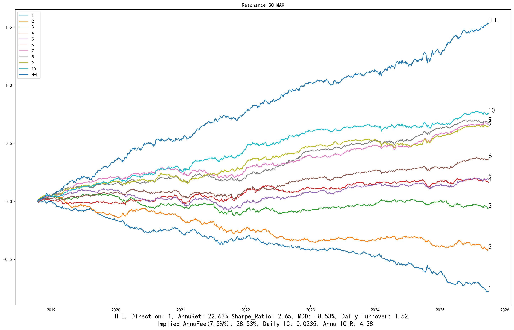

展开：分组平均收益、G10与基准、相对回撤

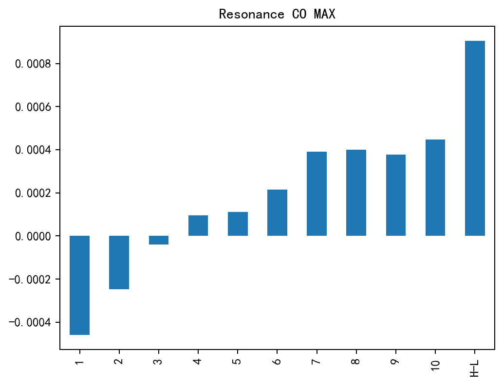

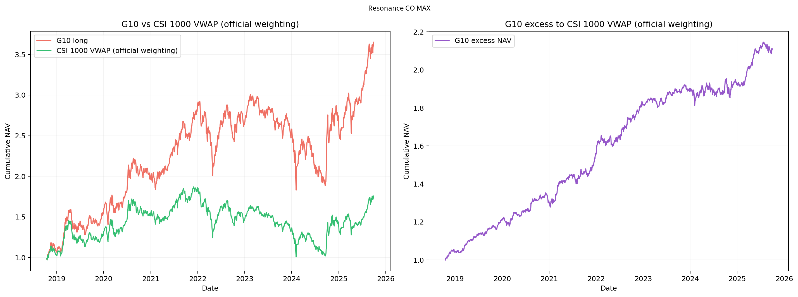

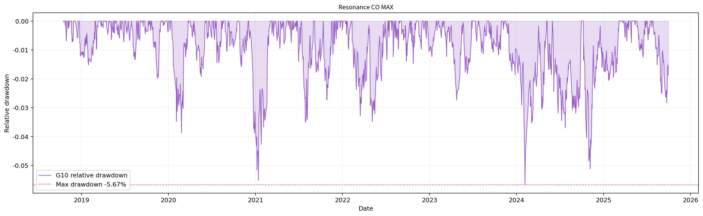

## CSI500

中证500历史成分股内选股，四张图来自同一版本、同一股票池。

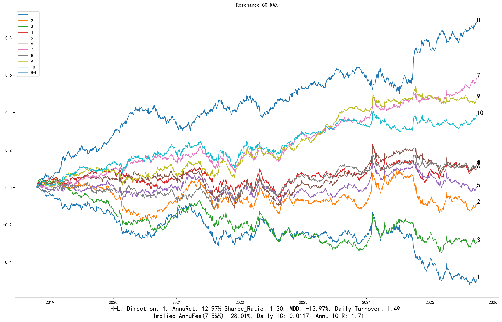

展开：分组平均收益、G10与基准、相对回撤

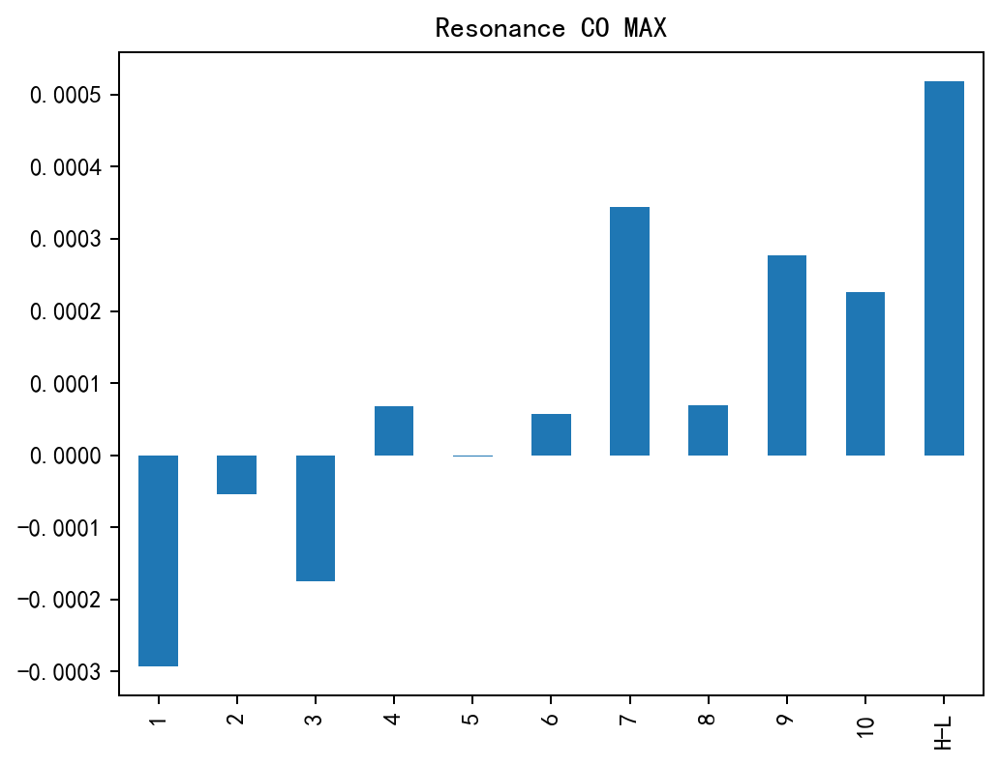

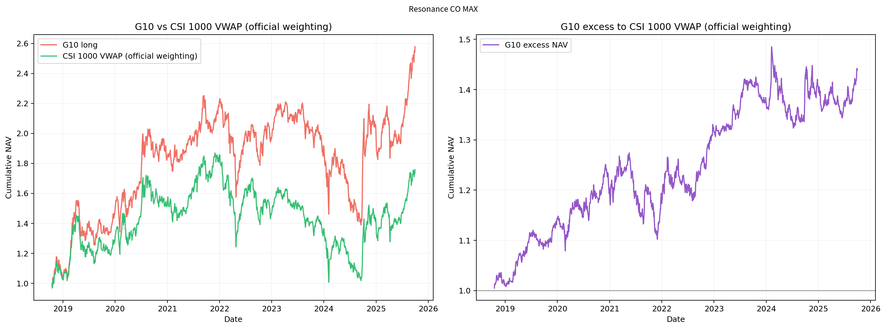

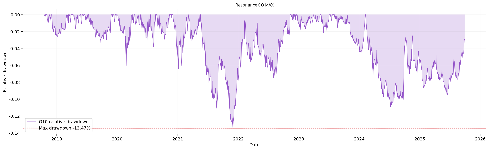

## CSI300

沪深300历史成分股内选股，四张图来自同一版本、同一股票池。

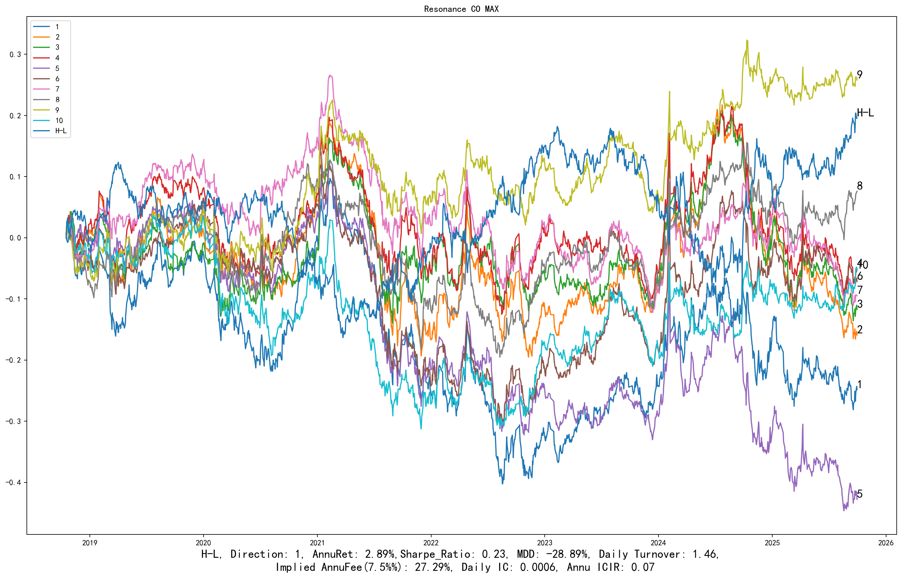

展开：分组平均收益、G10与基准、相对回撤

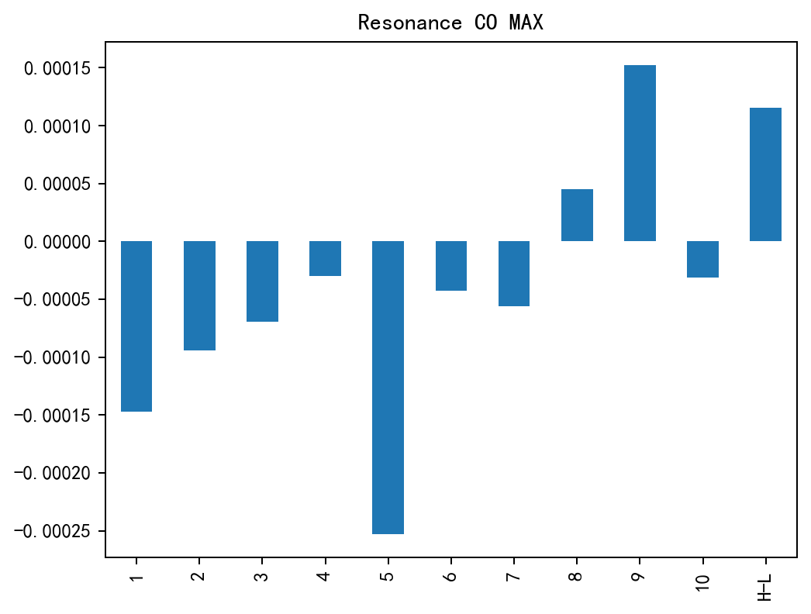

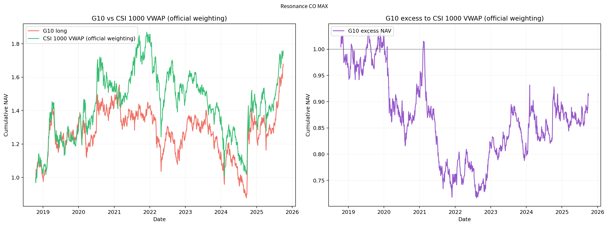

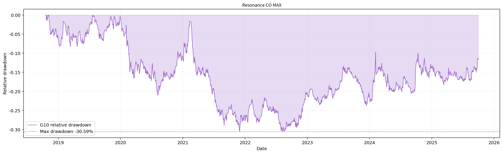

[返回十因子总表](README.md) · [返回主页](../../../README.md)
